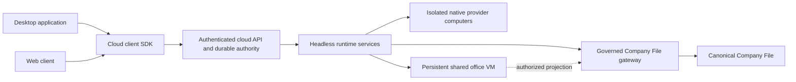

# Step 4 integration and headless runtime

Status: local implementation and the final Steps 0–4 audit are complete.
The candidate remains unreleased, with explicit live acceptance gates.
See [the final local audit](RUNTIME-STEPS-0-4-LOCAL-AUDIT.md).
The authoritative current requirement map is the
[Step 4 acceptance ledger](RUNTIME-STEP-4-ACCEPTANCE.md).

The independent runtime owns native execution and shared-office lifetime.
Desktop and the separate static web application use the same browser-safe
client APIs for scoped intent, Company File operations and computer viewing.
Actual entrypoint checks verify that the runtime has no Electron dependency
and that the web client cannot import Node or runtime execution adapters.

Local acceptance now combines two actual SQL-authorized native staff runs,
two persistent Linux XFCE desktops, Chromium application work and governed
binary Company File publication/import with no member clients running. A
second proof discards the container/workbench, restarts PostgreSQL and restores
the exact canonical head and file closure in a fresh container, preserving the
machine reservation. See [the combined proof](RUNTIME-OFFICE-COMBINED-PROOF.md)
for measured results and fixture boundaries.

Node admission, capacity/demand, placement, computer/screen lifecycle records,
usage estimates and basic health/operator queries are implemented and tested
with their distinct uncertainty and retention rules. Local packaged web
File/review/export and watch/control/private-sign-in tests are also complete.
The ledger records current evidence without treating historical deployment
or earlier package hashes as acceptance of changed code.

Actual LXD/NAS boot/reset/adoption and durability, hosted login/TLS/Realtime,
installed Electron behavior and final signed external native artifacts remain
live acceptance gates. No release, signing, deployment or publication is
performed. Worker dispatch and isolated coding machines remain Orders 5 and 9;
the enabled office transfer surface explicitly rejects unsupported worker realms.

## Inputs and preserved baseline

- Current checkout: `fable/runtime-step3-wake-bus`, starting at `6286ac52c60444bed3f42757557d316426bbf0b8` plus the existing uncommitted Steps 0–3 review fixes.
- Tested local v14 bundle: `473052fc6bebba091fc8397eeaa3cb621c5d6d97273bfa586a80ccd832a24056`. Its evidence remains in `RUNTIME-FAIR-ADMISSION.md` and the task's `outputs/fair-admission-fix` directory.
- Component source: `cb07a0269`, branch `codex/runtime-step-4-computers-screens-handoff`, in `/Users/jonas/.codex/worktrees/5ced/Qorpera_Base-step2`. Import selected additions; do not merge the older runtime authority implementation.
- Specification: `/Users/jonas/work/Qorpera_Base-runtime/QORPERA-RUNTIME-CONTRACT.md`, especially §§12 and 19.

## Package boundaries

`packages/runtime` owns cloud execution, the native tool boundary, office guest services, screen supervision, and private viewer transport. It has no Electron or desktop dependency. The existing runner orchestrator owns scheduling and infrastructure adapters.

`packages/cloud-client` owns authenticated client APIs and shared wire representations. Its browser entry has no Node, filesystem, provider execution, or runtime dependency. Desktop filesystem adapters use explicit Node subpaths. Both the desktop and web clients submit intent, display state, and request scoped views/control through the same cloud authority.

Supabase owns durable admission, scope, leases, generations, effect receipts, and revocation. The office VM contains the persistent workbench and separate concurrent desktops. Provider harnesses and subscription credentials remain in isolated execution computers. Screens coordinate work; they are not security boundaries. Company File access uses its governed gateway or an equivalent authorized projection.

The desktop imports client APIs rather than native execution implementation. The independent `packages/member-web` app composes the same authority APIs and is packaged separately. Both clients are locally exercised with explicit auth/transport fixtures; installed Electron and hosted browser acceptance remain live gates. Runtime ownership is independent of either client; existing cloud RPCs and scoped gateways supply the service boundaries.

## Historical implementation checkpoints

The remaining sections preserve earlier development records. Statements such as
“remaining,” “unfinished” and “not integrated” describe their checkpoint dates,
not the current candidate. Consult the acceptance ledger above for current
implementation status, evidence and live gates.

## Implemented foundation

- Imported the selected Step 4 components and viewer assets from the supplied checkout, preserving its source and license hashes. The older runtime and raw-mount implementation were not merged.
- Moved the existing cloud execution, secret custody, recovery, and native worker entrypoints into `packages/runtime`; updated packagers and source provenance. Moved shared APIs into `packages/cloud-client`, with browser-safe root exports and explicit Node adapter subpaths.
- Added AST and actual bundling checks that reject desktop/runtime dependency crossings, including type-only imports. A browser execution test completes the existing login protocol using Web Crypto without Node globals.
- Added `20260908000100_runtime_office_registry.sql`: a separately bound persistent office, immutable logical policy, versioned staff access, and atomic native screen acquisition/check/renew/release. It reuses the full native binding and current authority. Registration cannot activate a VM or introduce provider credentials. Initial SQL grants admit only the shell capability; browser and desktop grants require the subsequent privacy/profile integration.
- An expired occupancy lease cannot be silently reclaimed. Stale cleanup cannot release another driver's lease. Exact cleanup remains possible after native authority or grant revocation.
- Added `20260908000200_runtime_office_effects.sql`: guest attempts consume the existing native effect receipt once, validate the exact input bytes and current principals/resources, and retain explicit work leases. Member-private runs cannot use the shared office. Failed or ambiguous work remains occupied even after screen release or expiry. Takeover and recovery issue generation/epoch-bound drain challenges; only a matching supervisor acknowledgement reaps the old occupancy. This reserves a pending member takeover, without yet minting member control or viewer access.
- Added mandatory guest effect admission/check/finish hooks, `CloudCompanyComputerEffectControl`, and `CompanyComputerDrainSupervisor`. Resource deadlines cancel guest actions using monotonic time; checks cannot extend them. Completion is recorded only after a successful guest result; errors retain durable occupancy. The drain supervisor waits for actual action completion and idle control-channel shutdown before acknowledging, retaining failed drain attempts.
- Added `20260908000300_runtime_machine_capacity.sql`: a founder-configurable machine ceiling (default eight), shared allocation accounting for native runners and the office, founder-stop enforcement, durable refusal notifications, and exact physical-deletion cleanup. Reservation, suspension, and unknown outcomes continue consuming one machine; time and screen count cannot free or multiply that allocation. The LXD provider checks admission before creation/start and persists deletion confirmation before retryable capacity cleanup. Retained live journals must be registered before new starts. This is provider integration plus SQL office admission, not a completed office lifecycle or fleet-inventory acceptance test.
- Added `20260908000400_runtime_office_browser_privacy.sql` and `20260908000500_runtime_office_browser_effects.sql`: member-owned browser profiles, explicit versioned consent, membership-incarnation fencing, and closed page automation through the existing native receipt ledger. Administrators cannot supply another member's consent; provider subscriptions supply none. Each persistent profile currently has one explicitly granted staff driver, and each staff screen one profile. Changing the grant fences idle browser channels as well as active work before replacement.
- Added whole-office sign-in entry/exit challenges. Agent actions, result replay, screenshots, new screen claims and ordinary takeover are unavailable throughout entry, private input and exit. Each challenge covers every registered screen, including idle desktops. Private input checks require the exact authenticated owner, current membership incarnation and acknowledged entry. The supervisor must confirm viewer/capture shutdown, all physical drains and the private surface before acknowledgement. Exit requires private browser/input/clipboard/capture cleanup and replacement of secret-bearing framebuffers. Cancelling before entry preparation does not mark an unknown profile ready. A changed login or company rejoin cannot revive old consent.
- Added `CloudCompanyComputerBrowserControl`, `CompanyComputerPrivacySupervisor`, and browser-safe `CloudCompanyComputerSignIn` intent/status APIs. Lost client responses recover the current challenge without replaying the transition. Source pins include all office adapters and the imported guest launch wrappers even before service composition selects them.
- Added `20260908000600_runtime_office_viewers.sql`: random single-use tickets, scope-bound redemption, fresh membership/incarnation checks, one durable member controller per screen, exact private owner/profile handoff, ordered input admission and generation/epoch-bound cleanup. Only keyed commitments of input enter the admission ledger, never keys, clipboard bytes or enumerable plain hashes. Expiry and socket closure cannot erase unresolved control.
- Added `20260908000700_runtime_office_member_views.sql`: current member screen discovery and recovery of the member's own issued/active/draining viewers, including expired control tickets after a lost response. Exact cancellation remains possible after membership revocation. It cannot cancel another member's viewer or acknowledge physical drain.
- Added the TLS 1.3 WebSocket listener, exact Origin/path checks, bounded binary ticket handshake, closed registry HTTP adapter, and active viewer stream barriers. Tickets never enter URLs, access-log fields, cookies, subprotocols or noVNC options. The existing server-side input and clipboard filters apply to both transports; noVNC's watch flag is only UI behavior.
- Added browser-safe `CloudCompanyComputerViews` and an authenticated noVNC raw channel. The shared viewer component accepts this channel, preserves coalesced initial frames and closes it on cancellation. The native WebSocket API completes the SDK-to-TLS-gateway path locally with certificate verification enabled. Desktop main/preload composition and the separate web application's UI remain to be connected.
- Added `20260908000800_runtime_office_supervisor.sql` and `CompanyComputerOfficeSupervisor`: the runtime discovers expired reservations independently of clients, preserves pending drain challenges, fences actual streams before physical work, and polls on the service lifetime. Restored already-private state installs the barrier without replaying entry preparation. Re-reading that privacy challenge preserves newer per-screen drains. Physical guest adapters and deployment service composition remain mandatory; the supervisor is not yet launched by a deployed entrypoint.
- Added `CloudCompanyComputerScreenControl` and `createCloudCompanyComputerSession`. `CloudNativeCompanyRuntime` accepts an explicit cloud computer-session factory using the actual admitted run and existing operation ledger. Session cleanup runs after native cancellation on success and failure; unconfirmed cleanup prevents successful completion.
- Connected the native service main to `createHttpCompanyComputerSessionFactory` through explicit `QORPERA_COMPANY_COMPUTER_URL` configuration and the distinct `qorpera-office-native` systemd credential. The canonical HTTPS route is fixed by deployment; descriptors contain scoped resource metadata, never transport credentials or paths. Private-audience and unavailable-office runs receive no office tools. The office TLS receiver re-derives native authority, consumes the original receipt through the existing guest endpoint and shared action gate, and confirms physical cleanup before exact SQL lease release. Unknown responses are not retried, released sessions cannot reopen, and uncertain guest cleanup retains quarantine. Pre-guest authority rejection does not leak local session capacity.
- Added `startCompanyComputerOfficeService`: one service lifetime composes the native TLS and member WSS listeners, shared screen gate, viewer authority, drain and privacy supervisors. Startup waits for current active-office reconciliation; recovered private state installs both viewer and guest barriers without replaying private-surface preparation. Cancellation, unavailable supervision and listener failures stop admission and close both transports before whole-guest cleanup. Member input checks inherit service cancellation, and late guest connections are destroyed. The contained Linux adapters are now composed by `CompanyComputerLinuxGuest` and `startCompanyComputerLinuxOfficeService`; the packaged entrypoint and adopted physical readiness remain required.
- Added `CompanyComputerLinuxCommands`: actual unprivileged Bubblewrap execution for Bash, xdotool and scrot. The adapter verifies zero host capabilities, `NoNewPrivileges`, finite cgroup v2 memory/PID/CPU ceilings and the provisioned workbench mount identity. Opened directory descriptors pin the workbench/home mounts; only the assigned X socket and private screenshot output are exposed. Host processes, network, provider/profile directories and canonical paths are absent. Process/output/I/O deadlines cancel work; unresolved cleanup stays tracked until actual exit. Results recheck live authority before release. The whole Linux guest now owns this adapter alongside the persistent desktop and physical resource drains.
- Added `CompanyComputerLinuxDesktopLauncher`: real XFCE/TigerVNC desktops under the same checked Linux boundary, with descriptor-bound existing screen state, private Unix X11/RFB sockets and current binding/readiness checks. TCP listeners, clipboard transfer, resizing and client overrides are disabled. Startup cancellation owns only startup; ready desktops persist after the request and all viewers disconnect. Stop closes viewers, terminates the actual namespace and removes ephemeral socket state while preserving desktop settings. Missing adopted state, failed startup, duplicate pending launches and revoked bindings fail closed.
- Fixed an observed cancellation race in both Linux adapters. Killing Bubblewrap's outer monitor during its startup fork could leave the namespace running before its parent-death signal was armed. A trusted Bash permission gate under Tini as namespace PID 1 now admits execution only after that signal is installed. Early cancellation closes permission without killing an unarmed monitor; later cancellation terminates the namespace and detached descendants. Actual exit is required for drain, and stalled setup remains quarantined. The packaged service must additionally enforce whole-cgroup shutdown for unexpected broker failure. The ordering is visible in [Bubblewrap 0.11.1's implementation](https://raw.githubusercontent.com/containers/bubblewrap/v0.11.1/bubblewrap.c).
- Added `createCompanyComputerLinuxBrowserLaunch`, a mandatory contained adapter for persistent granted profiles. The browser alone mounts its profile, assigned X socket and broker-private CONNECT relay. DevTools uses inherited pipes with no TCP debugging listener. Public IPv4 HTTPS destinations are resolved and checked before connection, with bounded traffic and live authority checks. Chromium retains its nested renderer sandbox. Managed policy denies password saving, uploads through file pickers, downloads, local files, developer UI and omnibox JavaScript. Browser UI and trusted CDP have distinct admission; [Chromium checks the DevTools URL policy before opening its UI](https://raw.githubusercontent.com/chromium/chromium/151.0.7922.34/chrome/browser/devtools/devtools_window.cc), while [JavaScript URL filtering requires the documented scheme pattern](https://support.google.com/chrome/a/answer/9942583?hl=en).
- Fixed browser pipe startup and physical shutdown using real Chromium probes. The installed CDP connector sends its first request without calling the transport's optional `open` hook. Closing its transport during graceful shutdown could kill Chromium before cookies flushed. The pipe now begins reading on the first send; shutdown closes network access first, allows a bounded browser flush, and requires namespace exit before releasing the profile. The manager owns pending launches and service cancellation.
- Added `20260908001000_runtime_office_private_surface.sql` and `CloudCompanyComputerPrivateSurfaceControl`. A service-only check authorizes preparation and idle browser lifetime against the exact current challenge, owner membership incarnation, profile version, active office/logical computer and acknowledged physical drains. Metadata recovery does not authorize a private browser. Entry acknowledgement rechecks authority under the office lock; revocation cannot block exit cleanup. Newer viewer drains must finish before reopening the same challenge, while a changed screen generation is rejected.
- Added `startCompanyComputerLinuxPrivateSurface` and its Xvnc-only display. Private sign-in mounts the selected profile and a dedicated initially empty tmpfs, with no shared workbench, persistent desktop, XFCE, autostart or other screen. Its returned transport accepts only the exact owner's private viewer; no automation, capture or X handle is exposed. Idle renewal and browser/display failure close the physical resources, preserve the profile and clear ephemeral state. A real RFB probe verifies typed input, isolation from the stopped desktop's autostart, revocation and a fresh display on reopen. The whole Linux guest now supplies the barrier, tracks pending launches, proves physical drains and restores shared desktops after exit.
- Fixed real page screenshot publication through `CompanyComputerGuestAutomation`. Browser chrome and the desktop panel reduce the page viewport, so page images preserve their actual bounded dimensions. Desktop screenshots still require 1920×1200. Receipts include surface, width and height; asset-reference JSON still does not deliver native model vision.
- Added `CompanyComputerLinuxGuest`: native sessions bind adapters without launching processes; receipt admission precedes real desktop preparation and screen-open success. Shared desktops survive native-session release and viewer disconnect. The guest owns pending starts, commands, browser managers, RFB sockets and private surfaces, retaining unknown cleanup until physical drain. Privacy entry stops all shared screens; exit removes private resources before shared recovery. A recovered private viewer must match the current owner, screen, profile and challenge before launch. Viewer cancellation owns startup only; a ready private browser survives disconnect.
- Added `20260908001100_runtime_office_shared_surface.sql` and `CloudCompanyComputerSharedSurfaceControl`. Persistent idle desktops renew current office, Company File, screen and staff-grant authority independently of native effects or viewers. This read-only check grants no native operation, browser profile or member input. Stale generations, pending drains, private state and revoked access fail closed.
- Added `startCompanyComputerLinuxOfficeService`, connecting guest failures to the service cancellation lifetime. An idle display/browser failure closes both actual TLS listeners and awaits physical cleanup; an unknown drain remains an error. Physical adoption, mounts and asset publication remain mandatory entrypoint dependencies.
- Added `CompanyComputerLinuxBoundary` and `20260908001200_runtime_office_guest_binding.sql`. Linux service startup now checks the current cloud machine allocation, exact office generation/image/bootstrap binding, protected adoption receipt, actual boot ID, kernel ceilings and every configured storage mount. Effects and idle shared/private lifetime checks repeat this boundary. The receipt must be root-owned, hash-matched and outside guest-accessible roots; aliases, unresolved review, volatile workbench filesystems, overlapping private/shared roots and mismatched mounts are refused. It is a read-only projection of the provider/adoption journal, not a migration executor or an activation grant. The real provider must still create and attest that projection and its NAS backing.
- Corrected the service test constructor mock so repository formatting cannot convert it into a non-constructible arrow. Final tests now run after the full formatting/type check; current passing service evidence supersedes the preceding checkpoint for that fixture.
- Preserved v14 and created a new local v15 activation candidate. No production activation has been applied.
- Corrected the browser probe's renderer lookup to bind CDP PIDs to the physical Chromium browser's process ancestry. Namespace-local numeric PIDs can otherwise collide with independent XFCE processes. The corrected probe verifies three actual renderers, their nested PID namespaces, seccomp, no-new-privileges and zero effective capabilities. This corrects the fixture; it does not claim a Chromium crash fix.
- Added `CloudCompanyComputerScreenshots` and `20260908001300_runtime_office_captures.sql`. The Linux service creates a publisher per admitted native run using protected object-gateway configuration. The exact operation envelope reaches the publisher; SQL rechecks the original receipt/resource lease, audience, screen, browser grant and privacy before publication. Upload uses the existing immutable object transport, and publication creates an artifact plus a retention hold. Capture reads require the completed result to match that artifact and recheck current authority before and after object I/O. PNGs are bounded to the existing 8 MiB object limit. Local SQL and adapter tests cover substitution, ambiguity, cancellation, changed bytes and revocation. This implements storage/read authorization; native model image delivery and a combined physical guest/real SQL/object gateway proof remain pending.
- Added capture delivery to native dynamic-tool results, exact call/envelope/image-hash issuance checks, and `20260908001400_runtime_office_capture_context.sql`. Every provider/compaction request reauthorizes the run's entire capture read set, including images replaced by summaries. Context-view audit records closed capture metadata without pixels. The native patch validates images before Responses Lite removes detail metadata and rejects provider-message media outside the issued tool-result path. Actual-native local, remote and remote-v2 compaction tests use a scripted loopback provider with both ordinary/default model metadata. The rebuilt Linux release executable and its capability are now pinned; the retained proof is `native-codex/linux-x64-capture-images-proof.json`.

## Remaining implementation, before release

The startup continuation adds `20260908001500_runtime_office_start_intent.sql`: durable member/native requests, exact generation/grant/receipt binding, shared machine reservations, provider preparation authority, cancellation without capacity release and current-generation member status recovery. Native tool discovery offers `computer_start` while the configured office is offline, through cloud RPC and the existing receipt ledger. The browser-safe `CloudCompanyComputerStart` exposes member intent/recovery to both clients. `LxdOfficeStartControl` pins complete provider configuration and subtracts registry latency from preparation authority; the existing durable LXD operation journal remains a separate component.

These start requests do not yet drive an autonomous provider loop. Provider assignment, journaled creation, reviewed copying, first boot, protected preparation/receipt reconciliation and configuration delivery are implemented in the continuations. Remaining startup work includes actual storage writer exclusion, matching activation and an agent continuation wake so subsequent native work can discover active office tools. Member UI wiring also remains. No synthetic SQL activation in a regression fixture is evidence of physical readiness.

The historical startup checkpoint passes the full repository check, 766 scoped tests in 48 files (567 runtime office, 44 shared client, 72 provider control/journal/plan and 83 native ledger/session/service regressions), and both disposable SQL drivers after all 170 migrations. The additional SQL concurrency driver exercises the concrete provider control adapter. Its local v15 candidate is `af1d84eb453dbd5e2706407d3d426f7ab058570cd3021e9580422bad792bc194`; evidence is retained in the task workspace's `outputs/step4-office-start`. The corrected native AMD64 artifact remains building, so native binary pins are unchanged. This is a verified startup-intent checkpoint, not completed Step 4 or a production-ready release.

The provider-affinity continuation adds `20260908001600_runtime_office_provider_assignment.sql` and `LxdOfficeProviderControl`. Infrastructure enrollment fixes one provider ID/policy per office generation before allocation; it cannot change hosts or adopt existing allocations. Reservation and preparation now require that enrollment, and old unbound RPCs are private. Closed provider discovery retains cancelled/disabled requests and their allocations so restart reconciliation does not invent a replacement. `qorpera.lxd-office-guest/v2` includes provider identity/policy in VM identity, expected configuration and the operation journal; old v1 journals are not silently upgraded. The provider ID is trusted configuration, not proof of the physical host; local daemon/host verification remains part of the physical policy gate.

The provider-affinity checkpoint passes 255 scoped tests in nine files, the full repository check, both SQL drivers after 171 migrations and two real Linux SIGKILL/restart cases with the v2 binding. Both concrete provider control adapters are exercised against SQL, including enrollment and disable/cancel lock races. Its local runtime v15 candidate is `221318e9d32d2b6d5425a289c4c969a093bc093734be2c10eb391296ac372999`; evidence is retained in `outputs/step4-office-provider-affinity` in the task workspace. Actual LXD/NAS preparation, adoption and activation remain unfinished, and native artifact pins remain unchanged.

The physical-policy continuation adds `LxdOfficePhysicalGate`: protected local policy loading, separate office image-signature verification and a canonical enrolled digest covering office scope/generation, VM plan, host identity, image evidence and storage. Current checks read Linux machine/boot and mount namespace identity, protected Unix socket, actual LXD certificate/name/version/architecture and private pinned VM image. Open journal/workbench descriptors are matched to kernel mount IDs before and after metadata checks. Supported storage is a separate persistent local journal and dedicated hard NFS v4.1/4.2 workbench with exact export/address, private ownership and rw/nosuid/nodev TCP mounting. The gate performs no creation, mounting, adoption, VM mutation or activation. An expired caller cannot replace an outstanding filesystem probe; its process-wide slot stays occupied until actual settlement.

The checkpoint passes the full repository check on 1612 files, 348 scoped tests in 13 files, one provider packaging regression and 15 actual Linux fixture checks at uid 1000. Those Linux checks cover protected files and actual descriptor/mount metadata; local tmpfs cannot satisfy the pinned NAS policy. They do not prove an actual NAS/LXD admission. Runtime v15 remains `221318e9d32d2b6d5425a289c4c969a093bc093734be2c10eb391296ac372999`; this provider-only source is not yet wired into a provider entrypoint/package. Evidence is retained in task workspace `outputs/step4-office-physical-policy`.

The following creation and inventory continuations compose current cloud preparation authority, discovery and the immutable allocation/operation journal with this physical gate. LXD-side mount propagation, reviewed adoption execution/receipts, restricted guest readiness, matching activation and continuation wake remain implementation requirements. The gate's expiring metadata observation is not NAS durability, guest readiness or cloud admission.

The separate native AMD64 build recorded a memory-limit kill of the app-server compiler under its two-job/6 GiB limit. The verified unchanged upstream `unused_mut` warning was not the cause. A guarded retry waits for the original container's remaining compiler job to exit, then reuses the exact verified source path/cache with one Cargo job, 7 GiB and no network, writing fresh artifact output. Native binary pins remain unchanged until Linux native acceptance passes. No candidate signing, release, deployment, publication, production migration or NAS adoption occurred.

The creation continuation composes these components in `LxdOfficeCreationWorker`. A durable operation journal precedes the published intent/allocation/create-command identity, and both precede SQL reservation. Lost committed reservation replies recover through discovery without a new allocation; published intent identities never recreate a missing operation journal, including behind an older requested-state snapshot. The worker checks physical and current cloud authority before one journaled create. Accepted operations resume by ID; unknown submissions, failed operations and cancellation retain their original allocation. Successful creation requires exact stopped-VM readback and returns `awaiting_adoption`; it does not boot, adopt, activate or release capacity.

Physical policy v2 additionally pins normalized project, effective network and global storage-pool records, including their complete configuration maps. Changed configuration behind an unchanged name fails. Prior v1 policies are rejected without implicit enrollment/journal migration. These metadata checks do not prove physical firewall isolation or daemon-side NAS mount propagation.

The creation checkpoint passes the full repository check on 1617 files, 389 scoped tests in 14 files, one provider packaging regression, 15 actual Linux file/mount checks and two existing Linux SIGKILL journal cases. Both SQL script modes pass after 171 migrations. `--creation-worker` uses real PostgreSQL and Unix HTTP to prove lost committed reservation recovery, one create POST, two operation polls and a stopped VM result while SQL remains provisioning with one charged allocation. Host/image/NAS authority and the VM are synthetic in that combined fixture. Runtime v15 remains `221318e9d32d2b6d5425a289c4c969a093bc093734be2c10eb391296ac372999`. Evidence is retained in `outputs/step4-office-creation` in the task workspace. Actual adoption, restricted boot/readiness, activation/continuation and the provider service loop/package remain unfinished. Final package acceptance must verify Linux installer artifact pins on Linux; the Darwin packaging regression skips that comparison.

The original native build has now exited with confirmed OOM failure. A first retry launch failed before creating a container because the historical image digest was unavailable. Inspecting the original container and retained image established actual builder `sha256:015864b58affc062b5323ca26e9a68f5a9439ba15fbeade3cfa0df769ee579b3`. The corrected single-job/7 GiB offline retry is running with that same image and verified source/cache, under container `qorpera-native-vision-build-v3-retry-1`. Native pins remain unchanged pending completed Linux acceptance.

The inventory continuation adds a real bounded Linux scanner and `LxdOfficeInventoryWorker`. The scanner hashes every supported regular file and records paths, inode/device, ownership, modes, timestamps and mount identity; it requires two matching complete passes. It refuses unsupported file types/links, foreign ownership, unsafe names/modes, local fallback, nested mounts, concurrent change or exceeded budgets without returning a partial inventory. These refusals require explicit handling of existing state before migration; unsupported files are never discarded or treated as empty. Pending filesystem work remains fenced after cancellation. The provider requires its original successful create with no later operation, checks current stopped-VM/configuration and physical/cloud authority around scanning, and persists the bound observation privately by digest. Neither this observation nor repeated scans establish exclusive NAS access or power-loss durability.

The protected review loader binds an operator-installed document to that entire observation and a validated adoption-plan digest, with explicit writer-fence evidence. Empty initialization requires the actual empty root; any existing file or directory requires migration review. Loading the review does not implement the live fence, validate profile grants, execute the migration, install a completed receipt, boot the guest or activate the office. Those are the next required implementation steps. The current inventory checkpoint passes 307 scoped regressions in 12 files, actual Linux inventory/protected-review checks and the existing two Linux operation-journal SIGKILL cases. The runtime bundle is unchanged. The Linux probe uses tmpfs and synthetic operator approval; it does not contact a NAS or create a real VM.

The adoption-copy continuation moves the pure layout/mapping logic into portable shared contracts, preserving runtime exports and keeping provider preparation independent of runtime implementation. `planLxdOfficeAdoption` compiles an exhaustive mapping into new private workbench/desktop/screen/profile roots. It preserves originals, requires explicit quarantine for undisposed or sensitive state and never infers profile grants from directory names. `executeLxdOfficeAdoptionFiles` adds real Linux copying with protected review/journal binding, a process-owned kernel flock, zero capabilities/no-new-privileges, source revalidation, fsynced complete-file publication without destination overwrite, partial-staging recovery and exact output inventory. Its immutable result is `copied`; it cannot substitute for a boot-bound receipt or activate the office.

The copy executor requires a live provider guard before effects, between chunks and at completion. Actual stopped-allocation/cloud/profile/export authority, process/supervisor composition and guest receipt installation remain unfinished. The kernel flock serializes this provider only; independent NAS writers and server durability still require the real storage boundary. Do not supply a permissive guard or start the guest because a copy result exists. Local verification passes 570 runtime office tests, 329 provider tests and seven bundle/headless/package checks, plus twelve actual Linux copy scenarios including three SIGKILL/restart windows. The Linux authority/approval fixture is synthetic and uses tmpfs. Runtime v15 is now `2a0101b12c90866c93754d579baa09c5821bd28595bc3702453dfa12c9a7771c` after the shared-code extraction; this is a local source-only candidate with no applied production activation.

The office-entrypoint continuation adds protected configuration and credential loading, signal-owned Linux service lifetime, a separate package with all Playwright resources and inert artwork, and a systemd unit with finite limits and whole-cgroup cleanup. Local tests cover configuration rejection, startup/shutdown races, actual Linux credential reads and package startup outside the workspace. This completes the process/package plumbing; provider preparation/activation, image installation and live systemd acceptance remain unfinished.

These are implementation requirements, not merely live smoke tests:

1. Finish physical startup/adoption and screen-generation replacement against the shared action gate. The Linux guest, service and packaged entrypoint now compose pending/active resource ownership, private surfaces and shared recovery; verify them together with real authority. Add browser-profile management UI and its read/recovery API for grant mutations; viewer and sign-in intent recovery are implemented.
2. Connect office power/start/stop, guest readiness, and live fleet inventory to the implemented machine admissions and drain/reap protocol. Verify all chargeable execution lanes are accounted for; a SQL reservation is not physical guest readiness.
3. Supply governed filesystem projection and install the packaged office entrypoint into a verified image. Feed verified provider/adoption attestations into the implemented Linux boundary and provision its protected capture-object gateway configuration. Screenshot publication and authorized reads are implemented; prove the physical guest, SQL and object gateway together. Native service selection, private office TLS transport and service-lifetime supervision are implemented. Complete final wallpaper/dock integration and prove whole-cgroup shutdown under the real service manager. Browser file transfers require a governed path because native file pickers/downloads are disabled.
4. Combine physical guest capture, real SQL, object-gateway publication and the accepted Linux native screenshot-image fence. The Darwin and Linux source builds and loopback image proofs are complete component evidence; they do not prove this combined path or real model vision interpretation.
5. Compose desktop viewing/control IPC and the separate web UI with the shared member APIs and tested WSS adapter. The viewer component accepts the SDK channel; trusted endpoint configuration, app lifecycle ownership, takeover acknowledgement UI and browser-profile management still require integration.
6. Review the completed implementation, then run real Linux/multi-screen acceptance without claiming fixture readiness as physical proof.

The known native `proposal_review` completion gap from Steps 0–3 also remains visible in the release decision.

## Work and acceptance gates

1. Reproduce the imported component baseline and preserve source hashes.
2. Extract client APIs and headless services; make dependency and browser bundling checks enforce the boundary.
3. Integrate durable office registration, screen/resource leases, profile grants, takeover, privacy, and machine ceilings with current run and effect authority. Test concurrency, revocation, ambiguous failures, and recovery against local SQL.
4. Connect the guest, screen supervisor, governed filesystem, tool-session lifecycle, image context, and private viewer transport. Verify real local effects where the environment supports them; never substitute mock results for live acceptance.
5. Connect client APIs and viewing/control adapters without exposing service credentials or moving execution onto a member device.
6. Re-run relevant Steps 0–3 regressions, package checks, and `npm run check`; review the resulting candidate before release.

The source handoff's 217 component tests are not proof of integrated Step 4 behavior. Real cloud VM startup, multi-screen operation, all-clients-closed execution, reconnect/control, and VM reset preserving the canonical Company File remain live acceptance requirements. Existing NAS adoption requires an explicit inventory and authorized journaled migration; this task must not mutate that NAS. Automated native `proposal_review` completion is an existing gap and must not be reported as complete.

No signing, deployment, publication, production migration, or NAS adoption is authorized before this work is completed and reviewed.

The capture checkpoint passes 484 office tests, 196 native regression tests, 19 client tests and 6 bundle/headless checks (705 distinct tests), the office SQL driver, all 168 migrations and 46 database test files, and the full repository check. Real Linux whole-guest and browser probes pass after the operation-envelope integration. The browser capture was visually inspected: the fixture field and saved result are visible in a 1911×1108 image. Those physical probes still use synthetic cloud authority and publication; native model image delivery remains pending.

## Earlier physical-boundary verification

The physical-boundary continuation passes 454 shared-office component/transport/service/admission tests, 19 shared client tests, 196 native receipt/session/service-selection regressions, and six bundle/package/headless checks (675 tests). Fresh disposable SQL verification applies all 167 migrations and passes the 46 existing SQL test files. The office-specific SQL driver additionally verifies guest allocation/image/bootstrap binding, shared idle-surface and private-surface authority, denied member access to its RPC, pending and newer viewer drains, profile/screen changes, membership revocation/rejoin and cleanup. It preserves coverage of real native receipts, two-screen privacy barriers, cancelled preparation, exact drain acknowledgements, concurrent screen claims, duplicate guest dispatch, competing native/office starts at a one-machine ceiling, native checks waiting behind privacy entry, competing member controllers, duplicate tickets/input, private handoff and client-independent expiry reconciliation.

TLS tests use actual encrypted loopback connections and the native WebSocket API with specifically trusted disposable certificates; certificate verification stays enabled. The native test connects the selected factory and real native operation ledger through TLS to the guest effect boundary. A service test cancels an in-flight member input admission and confirms the key never reaches the guest connection. SQL readiness, guest effects and physical provider state remain synthetic in these transport/service tests. The earlier 47 LXD provider regressions passed in the authority continuation; that provider code is unchanged. Full `npm run check` verifies the current bundle and the 100-source runtime / 156-input runtime graph / 12-input browser graph.

The separate real Linux probes use disposable Ubuntu 26.04 ARM64 containers with Node 22.22.1, Bubblewrap 0.11.1, Tini 0.19.0, Xvfb 21.1.22, xdotool and scrot. The command probe verifies shared workbench persistence, host network/environment/profile absence, zero capabilities, rejected nested user namespaces, assigned-screen X11 access, a 1920×1200 PNG, bounded output, private capture cleanup, and termination of detached `setsid` descendants after timeout, cancellation and close. It also repeats 12 immediate pre-execution stops and eight startup command timeouts. Kernel ceilings and changed mount identity reject execution; a revoked result is withheld even after an effect occurred.

The desktop probe adds TigerVNC 1.15.0 and actual XFCE 4.20 components. It verifies two concurrent desktops, independent pointer control, a shared workbench, a complete private RFB handshake, persistent displays after request cancellation/viewer disconnect, a real 1920×1200 PNG, existing-state admission, failed/immediately cancelled startup cleanup, exact binding checks, stop/reopen with settings preserved, viewer shutdown and detached autostart daemon termination. Final wallpaper/dock styling is not part of this proof. Authority and mount provisioning remain synthetic.

The browser probe adds Chromium 151.0.7922.34 and Playwright 1.62.1. It calls Qorpera's real navigation, fill, click and screenshot adapter against fixture HTTP content. The inspected captures are a 1911×1108 page image and the 1920×1200 desktop. Kernel status verifies renderer seccomp, no-new-privileges, zero effective capabilities and nested PID namespaces. Real keyboard tests verify developer UI denial, then demonstrate successful address-bar navigation before testing JavaScript denial. File pickers report cancellation, file/password pages are denied, a private-IP DNS answer produces no upstream dial, a synthetic persistent HttpOnly cookie survives manager shutdown/restart, and grant revocation closes the browser and removes ephemeral state. A component test verifies an opaque TLS exchange through the relay using a specifically trusted fixture certificate. Authority, mount provisioning, HTTP content and asset publication remain synthetic; there are no real provider calls or external browser network dials.

The private-surface probe uses a fresh X server and Chromium with no shared desktop mounts. A previously running desktop autostart process is physically stopped and does not resume during private input. The probe types synthetic sign-in content through real RFB, verifies exact private viewer binding and isolated mounts, and inspects a real 1920×1200 image. Revocation closes the browser, viewer socket and X server, preserves the profile, and removes temporary files. Reopening uses a new X socket directory and does not restore the previous sign-in page. The fixture's trusted inspection adapter is not exposed by the production private surface. SQL authority, drain coordination and content are synthetic; no real website login or external dial is claimed.

The `--guest` probe composes the real Linux guest, native effect endpoint, privacy supervisor and drain supervisor. Two XFCE desktops execute actual Bash against one workbench; a browser starts and publishes a real page PNG through the endpoint. Session release and viewer closure preserve shared desktops. Private entry drains both screens; a completed private viewer drain permits recovery of the same challenge, stale private viewers cannot launch a surface, and a recovered browser survives viewer disconnect. Exit destroys private resources and resumes shared work with its file intact. Whole-guest close removes ephemeral state. The inspected 1911×1052 image is Chromium’s blank page, validating capture delivery, not sign-in content or UI styling. SQL/native authority, VM adoption and asset storage are fixtures; this probe does not combine the actual TLS listeners with a real database. The service regressions separately use real TLS listeners and mocked physical failure to verify idle failure, startup cancellation and unknown cleanup.

The `--boundary` probe executes the concrete Linux readiness adapter as an unprivileged broker with zero capabilities. A disposable root attester prepares fixture receipts before that broker starts. The probe uses a persistent Docker volume for the workbench and separate tmpfs for private state; it checks actual boot ID, mount/descriptor metadata, kernel limits and receipt ownership. Broker mutation of the root receipt fails; symlinks, broker-owned receipts, changed boot IDs and a correctly hashed receipt with the wrong actual mount are rejected. Valid checks preserve working files created after initial adoption. The provider identity, empty-inventory approval and cloud responses remain fixtures. This is not NAS durability, a real migration or a provider image attestation.

The earlier low-level negative browser probe overlapped blocked navigations and observed a Chromium exit. Final negative probes wait for each error document to commit before continuing. This does not establish a fix for an upstream Chromium crash; aggressive navigation and crash-recovery acceptance remain outstanding. These local probes also do not establish whole-service private handoff, NFS adoption, physical deployment, governed file transfer, cloud asset publication or native model vision.

Evidence for this continuation is in the task workspace's `outputs/step4-linux-boundary` directory. Earlier `outputs/step4-headless`, `outputs/step4-authority`, `outputs/step4-privacy`, `outputs/step4-viewer`, `outputs/step4-native-office`, `outputs/step4-linux-commands`, `outputs/step4-linux-desktop`, `outputs/step4-linux-browser`, `outputs/step4-linux-private` and `outputs/step4-linux-guest` evidence are historical snapshots, not hash manifests of the current files. The latest local v15 candidate is `33d59883261d79e8c7178f261d8456665651ea350ee2bc3143905d53099e1239`; no production activation has been applied.

## Adoption receipt and Linux native checkpoint

Protected preparation control now publishes the exact copied-state adoption receipt as root:root 0444 outside all guest-owned state. Completion v2 includes its digest. The provider independently reads the receipt twice, verifies exact derived bytes and root ownership/mode, and retains its digest with preparation evidence. A lost acknowledgement can resume the original command; an acknowledged missing or altered receipt is refused. Partial completion publication preserves the existing receipt inode. The receipt records migration completion and never retrospectively labels an existing source as empty. It grants no active office authority.

The Linux AMD64 native release build completed successfully. Its 307,464,032-byte executable has SHA-256 `6bbe4704774454be5aff5501bfe4bbd5e023930ff87d187ca9e5ec4c333c8e8d` and reviewed patch `5eb9ee03406e843ceea1f81d046750aa16785c03a84315c7be96a6c68004eb9a`. Actual native execution passed twelve capture/compaction checks, an unissued-image refusal, 22 denied execution bypasses, revocation/stall checks and twelve baseline compaction cases. These used an offline scripted loopback provider, with no paid/model requests. The release compile emitted three previously verified warnings in unchanged upstream code; it completed with exit zero.

The accepted artifact metadata is now a runtime-bundle input independent of the compiled guest output. The packager's actual manifest replaces the current local guest pin; historical signed v56 recipes remain unchanged. A separate Linux AMD64 package run matched the manifest byte-for-byte, verified all 24 present artifacts and their embedded runtime/native pins, and executed the Linux-only equality regression. The signed runner image and Cosign bundle remain absent in this contract-only package; image/installer acceptance is not claimed.

Validation: full repository check on 1650 files without diagnostics or formatting changes; 224 provider, 127 runtime, 127 native-session and 16 package/headless tests (494 scoped tests); 52 actual Linux root-file/flock scenarios; real SQL after all 172 migrations through concrete creation, first-boot and preparation workers over Unix HTTP. SQL flow retains one create, one start, one preparation dispatch/upload, and the charged provisioning allocation. Physical VM/NAS/systemd authority in that SQL flow is synthetic. The Linux control cases use real kernel/filesystem custody with a synthetic system manager.

Local runtime v15 bundle: `61810fe6249caea00b76e6577e757a3936b7b89c2f1b553845dcef3a40958d85`. No release, signing, deployment, production activation or NAS mutation. Step 4 remains incomplete: protected service configuration/credentials, matching activation and agent continuation, full provider supervisor/image installation, actual systemd lifecycle and combined physical/SQL/object-gateway/native capture, power/replacement drain, governed filesystem/transfers, agent presence, desktop/web composition and final Steps 0–4 review remain. The known native proposal-review completion gap remains visible.

## Protected service configuration checkpoint

Added the packaged `qorpera-company-computer-configuration-control.mjs` root helper. It uses the existing process-owned kernel flock and actual boot checks, accepts only a bounded protected staged document and installs six fixed `LoadCredential` files as root:root 0400. The image tmpfiles fragment now provisions their root:root 0700 directory. Configuration must match completed preparation scope/generation, copied layout, workbench and private mounts, kernel limits, allocation/image/bootstrap/boot and the exact adoption receipt. Token syntax/separation and actual TLS certificate/key parsing run before writes.

The helper repeatedly verifies the current completed preparation invocation, original protected request/report/completion/receipt and unchanged staging. Its concrete systemd inspector also requires the exact ordinary service unit to remain inactive with no pending job. A root-only claim precedes atomic no-overwrite credential publication; a hash-only completion follows complete readback and final verification. Replays preserve bytes/inodes. Partial installation can resume after process death, but a completed claim cannot repair missing or altered installed files. Credentials are excluded from arguments, completion reports and diagnostics. Neither this helper nor the preparation helper starts or activates the ordinary office.

Validation passes the full repository check on 1653 files, 107 scoped runtime tests, seven package/headless checks, all 52 existing Linux preparation scenarios and 44 new actual Linux configuration scenarios, including SIGKILL after the first credential publication and replay in a new process. The initial hardlink fixture crossed two tmpfs filesystems and was corrected to create its alias on the same filesystem. Final tests ran after formatting. The Linux probes use actual root-file custody, flock and TLS parsing with synthetic credentials and a synthetic system manager; they do not prove a real systemd service lifecycle.

The real SQL/Unix HTTP creation, boot and preparation flow passes after all 172 migrations, with one dispatch per phase and capacity retained while provisioning. Configuration delivery is not yet connected to that flow. The current native guest was repackaged and verified on Linux AMD64: all 24 included artifacts and embedded pins match the exact manifest. Its signed OCI image and Cosign bundle remain absent in contract-only mode. No new native compilation was needed; the accepted image-capable executable retains SHA-256 `6bbe4704774454be5aff5501bfe4bbd5e023930ff87d187ca9e5ec4c333c8e8d`.

Current local runtime v15: `d583197d4ff454564cfd8d8190af3d7be1a12376399aad64f51c41250279a889`. Current guest manifest: `3c67c6277f5ad6cf42d36eb1a85605a345a88efdedec7f696710b5f8942fd9bc`. No release, signing, deployment, production activation, NAS mutation or model calls.

Next integrate provider-owned credential/configuration custody, fixed bounded LXD staging/dispatch and independent completion readback into the serialized lifecycle. Bind the endpoints, credential identities, preparation and installed configuration into current provider/SQL activation evidence. Retain unknown operations and acknowledged identities; do not replay preparation after activation or treat a report/port alone as readiness. Then add activation continuation wakes, ordinary-service start/recovery and the full supervisor/image installer. Actual systemd lifecycle and combined physical guest/SQL/object-gateway/native capture remain required, followed by power/replacement drains, governed filesystem/transfers, agent presence, desktop/web composition and final Steps 0–4 review (including the existing proposal-review gap).

## Provider configuration delivery

Implemented the configuration phase after acknowledged preparation. A root-owned local service-bootstrap document binds the exact provider allocation and contains canonical HTTPS endpoints, fixed IP listeners/origins and five credential path/length/hash references. The image bootstrap hash retains its existing signed-image meaning. Credential reads validate the opened local descriptor, root ownership, single-link custody, private modes and the provider's dedicated primary group. The generated service configuration derives all scope, generation, layout, mounts, limits and boot/adoption identity from verified preparation; tokens and TLS pairs are checked before staging.

The provider stages at most 192 KiB at the fixed configuration inbox, reads back exact bytes and invokes only the pinned root helper. Separate configuration journals bind the acknowledged preparation observation and preserve one dispatch through cancellation and process replacement. Shared journal internals preserve existing preparation journal bytes. Known operations resume; unknown submissions cannot use a guest completion to justify retrying. Local journals store hashes and bindings, not credential values. Raw credential and transport buffers are cleared after use.

Every effect rechecks current kernel, physical, SQL adoption, writer/copy/preparation, guest boot and protected configuration authority. The worker independently verifies all six installed root-only files twice and correlates the protected completion before publishing immutable observation/completion evidence. Missing acknowledged identities, changed installed files and substituted preparation are refused. Nested preparation IO remains occupied after caller cancellation until actual settlement. No ordinary service is started and SQL activation remains separate work.

Validation: the full repository check passes on 1664 files with no diagnostics or formatter changes. The transport/command/journal/boot/preparation run passed 281 tests across five files; the final configuration/bootstrap/preparation/host run passed 126 across four files. These runs overlap and are not additive. Four headless/package checks pass. Actual Linux credential custody passes 26 checks, and preparation/configuration/operation journals each pass two actual SIGKILL/Unix-socket recovery cases. The shared request refactor also passed all 44 Linux root-helper configuration cases, including partial-install process death; those helper scenarios use a synthetic system manager.

The final disposable SQL test applies all 172 migrations and runs creation, first boot, preparation and configuration through the actual Unix HTTP client. It recovers a lost committed reservation, retains exactly one create/start/upload/exec per relevant phase, resumes pending work after provider replacement and refuses reconciliation after real SQL provider disable. The office remains provisioning with one charged allocation. Physical VM, NAS/writer authority and systemd/helper outputs are synthetic in this combined SQL test; actual systemd or deployed storage acceptance is not claimed.

Current local runtime v15: `f8b52aa592be16d334397f959293c0172cfc95db8b2673fb28ebddf270ed7268`. Linux AMD64 packaging verifies all 24 included artifacts and exact embedded pins against manifest `95033cefd29f77e1134835a91b63e0343059134d70c7bfc19bb6307d33c9c920`. Native executable SHA-256 remains `6bbe4704774454be5aff5501bfe4bbd5e023930ff87d187ca9e5ec4c333c8e8d`; it was not rebuilt. The signed OCI archive and Cosign bundle remain absent in contract-only mode. No release, signing, deployment, publication, production/NAS mutation or model call occurred.

Next: matching restricted guest readiness and SQL activation, durable agent continuation, ordinary service startup/recovery and a serialized provider supervisor/image installer. Do not rerun preparation after activation, weaken active-office work authority, or mark SQL active solely to get past ordinary service preflight. Preserve the broader Step 4 work: actual systemd/guest lifecycle acceptance, safe power/reboot/replacement drains with capacity retained until verified deletion, reviewed legacy storage handling, governed Company File projection and immutable transfers, agent presence, desktop and independent web client composition, native proposal-review completion and combined physical browser/SQL/object-gateway/native-image acceptance. Live NAS/KVM/production acceptance requires deployment and is outside current authorization. The Step 4/headless goal remains active and incomplete.

## Startup authority and activation handshake

Implemented the SQL/runtime handoff between installed configuration and active office work. SQL retains immutable intent/provider/allocation identity, preparation/configuration/receipt digests, guest boot and exact listeners. The prepared state grants restricted startup only. A readiness report pins one nonzero systemd invocation; its five-second freshness never permits another invocation to take over. Activation rechecks current source, provider, adopted grants and drained surfaces under the existing lock order, then atomically marks the office and activation active. Exact committed replies recover without rerunning preparation. Provider preparation-disable still permits read-only status and does not revoke an already active office.

The production service derives startup identity from protected configuration bytes and INVOCATION_ID. It performs physical preflight, binds native TLS and viewer listeners with admission closed, and reports readiness while waiting. Only matching provider activation followed by active physical/SQL preflight and initial supervision opens ordinary work. Rejected/cancelled startup closes both listeners and drains the guest. Existing active-work checks remain strict. Provider prepare/status/activate RPCs are excluded from the office registry transport; its startup controller cannot activate itself.

The provider SQL adapter freezes retained evidence and mappings, validates every reply against the exact identity and invocation, bounds calls and handles cancellation even when registry IO ignores its signal. It does not automatically repeat effects after unknown replies. This adapter is the SQL part only: the provider activation worker, protected ordinary-systemd start/inspection helper and lifecycle supervisor still need implementation. A SQL readiness record does not prove a real service is running.

Validation: the full repository check passes on 1669 files with no diagnostics or formatter changes. The final runtime run passes 123 tests across six files, including actual TLS/WSS refusal during standby and failed-start cleanup with synthetic physical/SQL adapters. The provider activation/start run passes 48 tests across two files. Four headless/package checks pass.

The disposable PostgreSQL activation test applies all 173 migrations and connects the actual runtime startup and provider activation adapters to SQL. It covers competing invocations and concurrent activation, exact replay, readiness expiry, owner cancellation, a provider-disable lock race, altered identity/ports, service-only permissions and capacity retention. Physical readiness is synthetic; these tests do not run actual systemd or an office VM. The separate 173-migration configuration regression still completes create, boot, preparation and configuration through the actual Unix HTTP client with one dispatch per phase, process replacement, lost-reservation recovery and provider-disable fencing. Physical VM, NAS, writer authority and systemd/helper results remain synthetic in that combined test.

The final Linux AMD64 package matches all 24 included artifact hashes and embedded runtime pins. Local runtime v15: `106f54e5f9b0fc5f19b4e25d250cb948db7f51ba7eb81208fadf10488dba48f6`. Guest manifest: `83dbadb471cc2967a4051d08574a720ec1d15a89c38af330bf5f9ce1a8f45caa`. The accepted native executable remains `6bbe4704774454be5aff5501bfe4bbd5e023930ff87d187ca9e5ec4c333c8e8d` and was not rebuilt. The signed OCI archive and Cosign bundle remain absent in contract-only mode. No release, signing, deployment, publication, production/NAS mutation or model call occurred.

Next is the protected ordinary-service start/measurement helper and provider activation worker with durable recovery, followed by activation wake/agent continuation and the serialized supervisor/image installer. Current SQL deliberately retains its original invocation after expiry; safe service restart/reboot/replacement requires explicit provider recovery and is not yet implemented. The broader Step 4/headless goal remains active and incomplete; this checkpoint is not production readiness.

## Protected ordinary service start and inspection

Implemented the fixed root service-start helper and packaged entrypoint. A bounded closed request binds acknowledged configuration completion to activation boot, configuration and adoption receipt digests, and listener ports. Under the existing real kernel flock, the helper rechecks actual boot, preparation request/report/completion/receipt, the configuration claim/completion and all six installed root-only files. Configuration directories retain root:root 0700 custody. Credential buffers are cleared after checking.

The fixed systemd adapter verifies installed unit bytes against packaged copies and rejects drop-ins, reload requirements or changed user/type/restart policy. It inspects the retained completed preparation and the ordinary unit's invocation, PID, cgroup, job and restart count. Common systemd IO was extracted without changing preparation's requirement for ordinary inactivity. The empty Job representation and boolean output were checked against the primary [systemctl formatter](https://github.com/systemd/systemd/blob/v257/src/systemctl/systemctl-show.c#L1051) and [property printer](https://github.com/systemd/systemd/blob/v257/src/shared/bus-print-properties.c#L76). This source check does not establish actual systemd lifecycle acceptance.

The helper persists a protected immutable claim before issuing one ordinary service start. A surviving claim can recover the same running invocation; an idle/failed unknown outcome never permits another start. Repeated confirmation preserves the original completion bytes/inode. Changed invocation, PID, cgroup, restart count, credentials or preparation evidence is refused. Completion records running-unit identity only; the service's SQL readiness and provider activation handshake remain mandatory.

A separate inspection mode accepts the original start command plus a distinct inspection UUID, rechecks the current unit and installed evidence and publishes a protected observation at a fixed nonce-derived path. It cannot start a unit, recreate a missing start acknowledgement or reuse a changed invocation. The provider must bound a newly dispatched inspection operation; neither an old completion file nor an old successful LXD operation proves current liveness.

Validation: the full repository check passes on 1676 files with no diagnostics or formatter changes. The final runtime run passes 133 tests across six files. Forty Linux AMD64 helper scenarios pass using actual root-owned files, real kernel flock and process replacement, including SIGKILL before/after the start, lost replies, no repeated start, fresh inspection and refusal to reconstruct missing acknowledgements. The systemd manager is synthetic in those scenarios. Existing Linux preparation/configuration helpers still pass 52 and 44 scenarios. Four headless/package checks pass; the office package contains the new helper and its standalone argument/help checks pass. The disposable SQL activation regression still passes after all 173 migrations, with synthetic physical readiness.

Linux AMD64 native guest packaging verifies all 24 included artifacts and exact embedded pins. Runtime v15 is `33b28b63e984855e6b7041251a7aaa7fb526927debaefcdea34231135e45828e` and the guest manifest is `c72217def781ce0017ca197be8f41ecb254dddd9d62b0c44a01b2e4bc47715d3`. The accepted native executable remains `6bbe4704774454be5aff5501bfe4bbd5e023930ff87d187ca9e5ec4c333c8e8d`; it was not rebuilt. The signed OCI archive and Cosign bundle remain absent in contract-only mode. No release, signing, deployment, publication, production/NAS mutation or model call occurred.

Next: provider-side service-start/inspection transport, journals and activation worker connecting this helper to SQL. Preserve retained configuration after ordinary service start; never rerun the preparation/configuration phases against a running office. Fresh inspection needs a new provider-owned nonce and an end-to-end authority deadline. Provider restart must recover the same start command and SQL activation without duplicate service start. Explicit ordinary-process restart/reboot/replacement recovery, durable agent wake, the lifecycle supervisor/image installer and the remaining Step 4 integrations are still incomplete.

## Provider service activation checkpoint

Implemented `LxdOfficeActivationWorker` as a headless provider component. It requires acknowledged preparation and configuration, reconstructs the exact retained configuration from protected provider sources and rechecks the original allocation, policy, host/guest boot and all six installed root-only files. It never invokes earlier workers or rechecks mutable copied working files. Provider activation calls remain separate from the ordinary office registry transport.

The worker retains one activation request and command, creates a separate immutable service-start journal before publishing its dispatch index, and prepares the matching SQL activation before the ordinary service starts. A fixed 16 KiB LXD staging lane and root helper argv expose no shell or command selection. Missing or altered retained identities refuse reconstruction. A command whose submission is unknown is never repeated; exact root completion plus a new successful inspection can recover a lost start reply while the unknown journal remains retained.

Fresh inspection persists a new provider-owned nonce before dispatch and binds the original command, configuration, activation, invocation, PID and cgroup. One monotonic five-second lifetime includes local publication, LXD execution/polling, protected readback and the SQL consumer. The worker checks that lifetime again after SQL readiness lookup, including when timer delivery is delayed. Cancellation retains pending inspection IO until settlement; no old successful operation can be reopened to renew freshness. Prepared or expired matching readiness waits; a different pinned invocation is refused even after expiry.

The final transition requires matching fresh SQL readiness and root inspection. Lost committed activation replies recover the same active identity without preparation. For an already committed active SQL state, the existing idempotent activation RPC revalidates active guest authority; SQL states do not regress. Preparation disable therefore blocks new starts but permits exact active recovery. The worker stores a protected completion and leaves capacity allocated.

Verification: full `npm run check` passes on 1686 files without diagnostics or formatter changes. A seven-file provider regression batch passed 390 tests; the final activation-worker file passed 22 cases after adding the expired-conflicting-invocation guard, superseding its 21 cases in that batch. The six runtime files pass 133 tests across two focused runs. Three Linux AMD64 journal probes use actual private files, Unix HTTP and SIGKILL at submission/acceptance, with no duplicate effect (six crash cases total). Four headless/office-package checks pass. The previous protected root-helper checkpoint remains hash verified and its actual Linux helper proofs remain separate from the provider tests.

The combined disposable PostgreSQL/Unix HTTP test applies all 173 migrations and executes actual creation, boot, preparation, configuration and activation workers. It deliberately loses the ordinary start reply and first committed SQL activation reply, then replaces the provider and disables preparation. The final result has one creation, one VM boot, one ordinary start, one service-start upload and four fresh inspections, with one unreleased allocation and active office. The root helper, systemd, physical host/NAS gate and copied content in this combined test are synthetic. The separate SQL activation concurrency/permissions regression also passes. No actual systemd lifecycle, NAS durability or production acceptance is claimed.

Runtime v15 is `984a0696d9ab6bb9e5eb55b3af0f5832ad59b36f417e04a4910ef7f67ca035a1`. Linux AMD64 packaging reproduces native guest manifest `f341d5487a1b6e4356514f14835f7b97c623688fcd37a24adc12bab83daf7268` and verifies all 24 included artifacts and embedded pins. The accepted native executable remains `6bbe4704774454be5aff5501bfe4bbd5e023930ff87d187ca9e5ec4c333c8e8d` and was not rebuilt. Contract-only packaging still excludes the OCI archive and Cosign bundle. No release, artifact signing, deployment, publication, production/NAS mutation or model call occurred.

Next: durable activation wake and agent continuation, then serialized lifecycle composition and image/credential installation. Explicit ordinary-service restart/reboot/replacement recovery remains unfinished; SQL currently retains a single invocation and does not adopt a new one by expiry. Inspection attempts currently retain nonce records for recovery/evidence; the lifecycle supervisor must provide bounded scheduling/retention before continuous operation. Full Step 4 also still needs governed file transfer/projection, agent presence, desktop and independent web client flows, native proposal-review completion and combined physical acceptance. This checkpoint is not a production release recommendation.

## Office activation continuation checkpoint

Accepted native `computer_start` now retains a private durable waiter even when it joins a member-created intent. Requests from the same run coalesce, while the original member/native intent provenance stays intact. Delivery claims do not execute work: the existing wake materializer scans them fairly and creates one ordinary agent wake only after the exact office activation and successful parent job completion with confirmed receipts. Failed/cancelled work is not silently revived; uncertain original execution still requires its normal recovery.

The source is explicitly `office-activation`, not a human input or coworker message. Its occurrence key binds intent and parent run. It preserves the parent's causal chain without inventing a sender or appending the same agent to the coworker loop fence. It has no public conversation or extra reply obligation. The current office generation, allocation, grant version, staff version, parent source authority, standing sponsor and autonomous consent still apply. Founder pause leaves pending demand waiting. Revoked authority cancels delivery without poisoning the queue. Profile contention retries before office locks, and the existing wake ceiling and compute admission remain in force. Original publication/review policy is retained.

The existing attributed, hash-bound `continuation` context source supplies parent inputs, job/wake data, confirmed receipts and prior sends; room input and routine intent stay attributed historical data. Context chains are bounded before admission. Current source and inherited path checks fence context release. Sponsor handoff retains the office continuation alongside that run's own completed work. Runtime instructions distinguish these two continuation forms and prohibit replaying earlier completed effects. The actual headless native session factory discovers active office tools for the continuation without a desktop or browser connection.

Verification: full `npm run check` passes on 1686 files without formatter changes or diagnostics. Five selected runtime/native files pass 122 tests, including 14 closed office-envelope cases. Disposable PostgreSQL applies all 174 migrations; 20 activation/continuation checks cover real receipt and parent completion RPCs, member/native coalescing, concurrent consumers, rollback, database restart, profile contention, current revocation and actual TypeScript context/tool discovery. The broader wake suite passes both historical/current regression lanes and all 25 integration cases for the five entrypoints, reply policy, sponsor handoff, stop and ceilings. Its probe now bundles headless workspace source, and its historical/current contention assertions account for fair queue retries without weakening delivery identity checks.

The concrete creation/boot/preparation/configuration/activation worker SQL and Unix HTTP probe also passes after all 174 migrations: one creation, one VM boot, one service start, one upload and four fresh inspections, recovering lost start and committed activation replies. These combined SQL tests use synthetic physical host/VM/systemd/copy facts and offline native output. They do not prove a live guest/NAS lifecycle or model behavior.

Runtime v15 is `9968db8ff9df6d65dc887b7330cce9cfcceb9efd627692be32636c620dd6f444`. Actual Linux AMD64 packaging reproduces native guest manifest `73e1e7927654f0ad11d693771d28f7e683019ab68faeabb2265115f797dc8f53` and verifies all 24 included artifacts and embedded pins. The accepted native executable remains `6bbe4704774454be5aff5501bfe4bbd5e023930ff87d187ca9e5ec4c333c8e8d` and was not rebuilt. Packaging is contract-only; OCI/signing artifacts remain excluded. No release, signing, deployment, publication, production/NAS mutation or model call occurred.

Next: compose the verified provider components into a serialized lifecycle supervisor/entrypoint with separate provider HTTP control, process-owned kernel locks, installation and bounded inspection retention. Explicit service restart/reboot/replacement, safe power-off/drain/capacity release, governed file transfer/projection, agent presence, desktop and independent web flows, native proposal-review completion and combined physical acceptance remain unfinished. Step 4 and the overall goal remain active; this is not production release approval.

## Serialized office provider checkpoint

The headless provider now composes creation, inventory, protected review, adoption, first boot, preparation, configuration and activation under one process-owned kernel lock. Eight immutable phase records bind the enrolled policy, intent, allocation, inventory and operator request. A phase transition is fsynced before its worker may dispatch. Recovery verifies the hash chain and refuses missing/corrupt records or later physical dispatch evidence that would roll back into an earlier phase. Existing component journals without the supervisor fence require explicit recovery; no automatic import or reconstruction occurs.

The supervisor runs one phase per tick and awaits worker settlement. Creation, inventory and adoption expose settled composition methods; the actual copier also retains cancellation until its underlying work settles. Missing protected review leaves the office waiting. Review, writer exclusion and credentials remain explicit protected infrastructure inputs. Cancellation, maintenance and disabled preparation hold work and preserve charged capacity. Active recovery uses the activation worker directly and never replays preparation/copy verification against mutable working files. Normal active ticks read cloud metadata without repeated fresh guest inspections; guest health and admission remain the runtime's responsibility. A fresh provider process independently rechecks activation once.

The separate provider registry exposes only seven HTTPS RPCs, accepts an infrastructure credential and refuses redirects, arbitrary REST, enrollment, cancellation, deletion and automatic retries. Requests/replies and IO are bounded, and errors redact backend bodies and secrets. The protected service entrypoint reads an exact credential hash/length from a private root-owned local file, keeps the loop independent of clients and deduplicates unchanged observations. A hard budget of 256 retained inspection attempts per allocation bounds host/guest evidence; exhausted or malformed evidence requires reviewed recovery rather than deleting uncertain operations. This is a bounded fail-closed budget, not automated cleanup.

The actual Linux service probe found a Node 22 jitless compatibility issue. Native web response classes load Undici/WASM, and the ESM facade for node:http additionally evaluates its WebSocket export. The provider registry now uses bounded native HTTPS, and the standalone provider package uses CommonJS, preserving --jitless, disabled prototype mutation and disallowed string code generation. No protection was relaxed. The disposable probe's root driver needed CAP_KILL to signal its different-UID child; the provider itself runs with zero permitted/effective capabilities and no-new-privileges.

Validation: the full repository check passes on 1695 files with no formatter changes or diagnostics. The selected 11-file run passed 273 tests; three additional settled-cancellation cases and one actual TLS case bring the covered union to 277 tests in 12 files. The final affected subset passed 123 tests in seven files after the transport/entrypoint changes. The standalone package/help/invalid-config regression passes. Loopback TLS exercises successful RPC, redirect refusal, oversized replies, cancellation and a real five-second timeout without replay.

Disposable PostgreSQL applies all 174 migrations. Both the original worker flow and the new composed lifecycle flow pass over real SQL and Unix HTTP. The composed flow recreates the supervisor between phase calls, retains all eight records and produces one creation, one boot, one preparation/configuration upload each and one service start, recovering lost committed reservation, lost start and lost committed activation replies. It retains one charged allocation and active recovery after preparation disable. Physical host/VM/NAS inventory, byte copying, writer exclusion and systemd are synthetic in these SQL tests.

Actual Linux AMD64 Node 22.22.1 packaging reproduces manifest `e7f9a926a7fafb772f265e8f5816c571b68bafa0d8aa360150a7b61fca1e42b7` and provider artifact `ac91d32bda417db82491fd7926a3f958ba261c0f2dd1242aaaedccde8255f3ad` (297280 bytes). The running packaged service reads actual root-owned protected credentials, holds a real unprivileged process-owned flock, excludes a competing process, refuses an absent lock and unsafe credential permissions, deduplicates unchanged logs and exits on SIGTERM before a replacement acquires its lock. TLS cloud authority in this Linux probe is synthetic idle metadata; it creates no VM and runs no systemd manager. Sources are mounted read-only and the container has no external network.

Runtime v15 remains `9968db8ff9df6d65dc887b7330cce9cfcceb9efd627692be32636c620dd6f444`; native guest manifest remains `73e1e7927654f0ad11d693771d28f7e683019ab68faeabb2265115f797dc8f53`. The accepted native executable was not rebuilt. No release, signing of a candidate, deployment, publication, production/NAS mutation or model call occurred. Test signatures/certificates cover disposable synthetic fixtures only.

Next: install the provider and image/credential boundaries, verify actual systemd startup/restart/whole-cgroup shutdown and mount propagation, then implement safe power-off/reboot/replacement with admission revocation, drain and physical deletion before capacity release. Governed File projection/transfers, agent presence, desktop and independent web flows, native proposal-review completion and combined physical acceptance remain unfinished. Step 4 and the overall goal remain active; this checkpoint is not production release approval. Cumulative skills used remain one historical openai-docs skill (cap 10).

## Node 22 and host namespace service checkpoint

The runner provider and orchestrator packages now require Node builtins through a CommonJS payload while preserving their existing .mjs executable paths. Their private service HTTP ports use pinned @whatwg-node/node-fetch 0.8.6 request/response classes and bounded native HTTP/HTTPS, without Node 22's Undici/WebAssembly initialization. The ports expose only the operations actually consumed: headers, JSON, bytes and cancellation. Header inputs are copied before override/redirect stripping; the transport also honors a Request object's own cancellation signal. Multipart forms and cloning are outside this private service port. The dependency lock changes only add the four exact resolved package entries and the direct workspace dependency; no install scripts ran.

The executable regression runs each service with its ordinary globals and with global fetch/Headers/Request/Response access forbidden. Real loopback requests exercise provider startup, unauthorized requests, repeated orchestrator polling, durable control-token rotation, gateway health/invalid login, web-service JSON and graceful SIGTERM. All pass on Linux AMD64 Node 22.22.1 with --jitless, --disable-proto=throw and --disallow-code-generation-from-strings. The cloud authority, process backend and login refusal are synthetic; no VM or paid provider is invoked. The first-node provider/orchestrator installer pins were regenerated from the actual Linux artifacts. Native guest packaging exactly reproduces 24 available artifacts and current runtime pins on Linux; the previously accepted native executable was reused without compilation.

A real root-PID-1 probe also confirmed that a dedicated unprivileged service cannot read /proc/1/ns/mnt. The office host observer now falls back only for EACCES/EPERM to a root-protected local record, binds its boot ID to the currently observed boot, and compares its namespace with the provider's real kernel namespace. The new fixed no-argument root helper reads PID 1 directly, verifies that it is in that same namespace, fsyncs and atomically publishes /run/qorpera-office-provider/host-mount-namespace.json, and rejects unsafe existing custody. No namespace descriptor or capability passes to the provider. The separate root startup unit is bounded to CAP_SYS_PTRACE because reading a PID with different protected credentials/capabilities requires it. The provider's inherited, permitted, effective, bounding and ambient capability sets remain empty.

Actual systemd 259 on isolated Linux ARM64 Node 22.22.1 exercised 16 service invocations with no-new-privileges, MDWE and jitless. The repository's root startup unit was copied into the disposable container, validated by systemd-analyze and executed. Dedicated non-root probes passed after capture and rejected missing records, another boot, a different namespace, writable/misowned files and symlinks. The helper refused unsafe existing records and refused to capture from a private mount namespace; a provider in a private mount namespace also failed. This is actual systemd acceptance for the namespace handoff, not a complete office-provider installation or NAS/KVM acceptance. The container used its own writable cgroup namespace; no host cgroup bind or production access was used. Its root test driver had the capabilities needed to run systemd; the tested provider probes had none.

Runtime v15 is now 55e26f165a8873547a1b8b8c00c366061bec4a18cabc72c0aa499ab4530af6ab because the runtime bundle binds the whole dependency lock. The native guest manifest is 65af0efae665f4e52b13aee5940be62e3bbf8c08a246c8586e2d5421b6a45496. The accepted native binary remains 6bbe4704774454be5aff5501bfe4bbd5e023930ff87d187ca9e5ec4c333c8e8d. The root namespace helper and changed office provider must be included in the eventual reviewed installation; earlier one-artifact office package pins are superseded by this checkpoint.

Next: complete the office provider/image/credential installer and service wiring, then verify its actual kernel lock, startup/restart/whole-cgroup shutdown and host mount behavior under systemd. The provider must share the private workbench's numeric owner UID to access its 0700 tree. Enrollment must establish that this is a dedicated host identity and that guest UID mapping agrees; do not silently reuse an interactive host user, change NAS ownership or broaden permissions. Its primary credential group must remain private. Preserve the host mount namespace: ProcSubset=pid hides required metadata; PrivateTmp, ProtectSystem, ProtectHome, ReadWritePaths and related options can create a private mount namespace and are incompatible with the physical gate. Use the independently verified root namespace startup unit, not extra provider capabilities.

Explicit guest restart/reboot/replacement, safe power-off with admission revoke/drain and verified deletion before capacity release, governed File projection/transfers, presence, desktop and independent web flows, native proposal-review completion and combined acceptance remain unfinished. No candidate signing, release, deployment, publication, production/NAS mutation or model call occurred. The goal remains active.

## Headless provider installation checkpoint

The office package now contains the provider, namespace helper and root installer executables plus both unit inputs. The installer binds the exact package manifest, enrolled policy, verified image provenance, service configuration and registry credential/CA. Read-only preflight checks the actual machine identity, architecture, descriptor-bound local journal mount, exclusive host UID/GID ownership, stopped processes and systemd configuration. Application takes inherited kernel installation/adoption flocks, creates the dedicated locked account and private journal only when safe, atomically installs exact files and a receipt, and leaves the provider disabled/stopped. Existing files and journal inodes are preserved; changed custody, partial retained installations, a missing retained lock and loaded or pending unit overrides are refused. See [the installation contract](OFFICE-PROVIDER-INSTALLATION.md).

The provider unit keeps the actual host mount namespace, has no capabilities and runs jitless Node with MDWE. It opens the existing adoption lock before invoking flock; missing paths cannot recreate it. Ordinary restart and failure restart reacquire the same inode, and mixed-cgroup shutdown removes remaining descendants. These are provider-process transitions, not guest reboot/replacement or evidence of VM deletion.

Validation: the full repository check passes on 1704 files with no fixes or diagnostics; 105 targeted tests across six files and the standalone package test pass. The repeatable repository command `scripts/test-office-installation-systemd.mjs` passes 18 acceptance checks using actual systemd 259, Linux ARM64 Node 22.22.1, a local ext4 loop-file journal, protected credentials and loopback TLS. It covers no-effect preflight, package/credential tampering, inherited and competing locks, unloaded/loaded overrides, exact disabled installation, actual zero-capability service startup, ordinary/crash restart, cgroup cleanup and retained-state refusal/preservation. The root fixture's startup scope needed more than its initial 38-task default to launch nested installer processes; its disposable container budget is 1024, while the actual provider unit remains capped at 128. No provider hardening was relaxed.

Package manifest: `ee76e4fb1c7949cdc6ce84ad5aaf1627191331908b334aee8e3502427e15be76`. Provider bytes remain `203ddd102b54c26179f2169655bd2eeb6e45c25ada16bde49f46c8069ea0133b`; installer bytes are `514078fd4ffed2a018756f23cbe72218e0c4366b931ab73f02e02bec39971eb8`. Runtime v15 remains `55e26f165a8873547a1b8b8c00c366061bec4a18cabc72c0aa499ab4530af6ab`; the accepted native binary and native guest manifest are unchanged and were not rebuilt. The exact source snapshot and logs are recorded under the task's `outputs/step4-provider-installation` checkpoint.

The installer never contacts cloud authority or starts a service. Acceptance explicitly starts the installed service only inside the disposable fixture, whose synthetic authority has preparation disabled and no start intent. There is no NAS/KVM, physical image or durability claim. Next are the guest image/dependency/runtime-directory installer and guest lifecycle transitions, then governed File projection/transfers, presence, desktop/web composition, native proposal-review completion and combined acceptance. Step 4 remains incomplete and release remains held.

## Guest image installation checkpoint

The standalone guest image installer binds the complete office package, exclusive numeric guest identity, OS/package-version inventory, required executable hashes and complete browser tree to explicit reviewed inputs. It installs the actual runtime paths, immutable systemd reference copies, boot-time credential/preparation custody and service-owned runtime directories. A separate demand-mounted tmpfs supplies the private sign-in workspace; its ordering avoids the local-filesystem/tmpfiles cycle. The image stays unconfigured, disabled and inactive. Existing company/configuration state, live office mounts, changed dependencies, reused identities and unit overrides are refused. See [the guest image installation contract](../lxd-company-computer-guest/INSTALLATION.md).

Actual systemd acceptance found two integration gaps and now covers both: systemd's escaped mount filename must be treated as a literal basename under a canonical protected directory, and the existing root preparation controller requires reference copies of both units under `/opt/qorpera-office`. The acceptance command invokes that real controller after installation. It passes 15 checks on Linux ARM64 Node 22.22.1/systemd 259, installing 136 pinned files plus a receipt, proving the private tmpfs flags/ownership, preserving identical reinstall inodes and refusing configured/company-bearing images. The provider installer's 18 actual systemd/ext4 checks also pass after shared file-helper changes; its service remains capability-free.

The full repository check passes on 1709 files with no fixes/diagnostics. Targeted provider/image tests pass 88 cases across six files; five compiled-bundle admission cases pass separately. Both office package tests pass, and three Linux AMD64 first-node/native package tests pass. Actual Linux packaging reproduces all 24 available native guest artifacts and current runtime pins while reusing the accepted native executable. The composed eight-phase lifecycle passes again over actual PostgreSQL/Unix HTTP after all 174 migrations, including lost reservation/start/activation reply recovery. VM/NAS/copy/systemd facts in that SQL test remain synthetic; actual installer systemd tests are separate evidence.

Runtime v15 is `bac20a1d201dedd557156250f7fba4d570210f2bbc694484a74eb2961bc20206`; native guest manifest is `92c6ff966e07590c3baf68942df88cfb1efb22e31466c2b1028caeff03cc29df`. Office image package manifest is `2bca6330c5ed22dab32a4e7ade0413d94320bc46eaa7aed77220663277a0d8f5`; provider package manifest is `3e80e67efe012710b113985d304c37695000e38090f64e07b011499eb55b4a1e`. The native executable remains `6bbe4704774454be5aff5501bfe4bbd5e023930ff87d187ca9e5ec4c333c8e8d` and was not rebuilt. Sources, package pins and logs are archived in the task's `outputs/step4-guest-image-installation` checkpoint.

This installs code into an already prepared local image; it does not acquire OS dependencies, build/seal a real LXD/KVM image, prove NAS durability or sign a candidate. Next are explicit guest service-invocation restart/reboot/replacement and safe power-off with admission revocation and actual drains, followed by governed File projection/transfers, presence, desktop/web composition, native proposal-review completion and combined acceptance. No production/NAS mutation, deployment, release, signing, publication or model call occurred. The full Step 4 goal remains active.

## Lifecycle admission revocation checkpoint

Migration 175 adds an explicit infrastructure-owned lifecycle request for service restart, reboot, power-off or replacement. The request binds the enrolled provider/policy, activated allocation, image/bootstrap, boot, configuration and prior service invocation. In one transaction it changes the office to maintenance, clears native leases/takeover authority, marks resources and viewers draining and records ordered screen challenges, action, time and revision. Existing pending challenges and private sign-in state are preserved. The same provider can revoke admission after preparation-disable or founder pause. A retry must match the entire original request; another transition or changed action cannot take over.

This is admission revocation only. The immutable response always remains `draining`; even successful screen acknowledgements do not imply that the ordinary service cgroup is gone. No stop acknowledgement, new invocation, boot, generation assignment or allocation release is implemented by this migration. The typed provider adapter exposes begin/status, retains uncertain IO until settlement and never retries automatically. The guest registry rejects both new provider RPCs. The existing lifecycle supervisor does not yet dispatch these recovery transitions.

The full repository check passes on 1712 files with no fixes or diagnostics. Targeted tests pass 123 cases across seven files, plus four Node package cases. Real PostgreSQL tests after all 175 migrations cover invalid bindings, paused/private/pending-drain recovery, concurrent admission versus revocation, competing identities, lost committed replies and database restart. The existing eight-phase activation/Unix HTTP flow and activation-wake/native-continuation tests also pass. Physical VM, boot, copy, systemd and resource facts in these database fixtures remain synthetic. This checkpoint adds no physical shutdown proof.

Runtime v15 is `99508621e171b55d3b11f217d151fc9e2703a94e0b6e4933bfe5f73a4da3d05a`; native guest manifest is `fe5b3007e79821194259b2cbd971df2a4b7369a561580959c802059943d2f32a`. Linux AMD64 packaging reproduces all 24 available native artifacts and these runtime pins using the unchanged accepted native executable. Office image package remains `2bca6330c5ed22dab32a4e7ade0413d94320bc46eaa7aed77220663277a0d8f5`; provider package is `0900ea0a1d63a7e701c0eb08ce7dbbbeb332341ebc99a9926f5397129b82eca5`. Sources and logs are retained in the task's `outputs/step4-lifecycle-revocation` checkpoint.

## Protected physical service-stop checkpoint

The fixed root stop helper consumes a protected request containing the retained SQL revocation and exact original start-completion digest. It rechecks current boot, process-owned kernel flock, acknowledged startup, installed configuration and adoption receipt. It reads no mutable workbench tree. A durable stop claim precedes the sole systemctl dispatch and fences the first-start helper. A retained claim permits observation only: a crash before dispatch leaves a live service unconfirmed; a lost reply after shutdown can recover the original completion. A fresh inspection nonce cannot reconstruct missing completion or cause another stop.

The real adapter compares unit state around descriptor-bound `cgroup.events` reads in PID 1's mount and cgroup namespaces. Completion requires an inactive/failed unit, no main/control PID or pending job, and an absent or empty fixed service cgroup. The record distinguishes the originally admitted invocation from a possible unadmitted automatic restart. The protected request is trusted provider-to-root data, not a signature or guest-callable SQL capability. Historical completion cannot replace a fresh inspection and a provider-owned deadline.

The provider now has bounded fixed-path staging/readback, fixed stop/inspection execution, and a separate durable journal for each lifecycle transition. The journal binds revocation and start-observation hashes, original allocation/boot and provider policy. Unknown submissions never repeat after restart. These transport/journal components are not yet composed into the lifecycle worker or a SQL physical acknowledgement. No new invocation, boot, generation or capacity release is admitted by this checkpoint.

The actual packaged command initially failed on Ubuntu's `/usr/bin/env` distribution symlink. The shared protected launcher now supplies an empty child environment directly, retaining executable custody and inherited no-fork flock ownership. Actual systemd verification now installs the current image package, kills a detached TERM-resistant child through the unchanged ordinary service unit, observes the whole cgroup gone, preserves mutable workbench bytes, and rejects first-start replay and stale inspection after a new invocation. Its nine stop checks and fifteen image-installation checks use real Linux/systemd/tmpfs/flock, but synthetic workload and SQL revocation. They do not establish real NAS/KVM or combined SQL/guest acceptance.

Verification passes the full repository check on 1721 files without fixes or diagnostics, 485 targeted Vitest cases in seven files, eleven Node package/boundary cases, nineteen protected stop failure/recovery cases, and forty existing protected start cases. Linux AMD64 packaging reproduces the native guest manifest and all 24 available artifacts using the unchanged accepted native executable. Its package check also found and corrected the first-node LXD provider checksum after the shared transport change. SQL is unchanged from the preceding 175-migration revocation checkpoint.

Runtime v15 is `bb5d5e5ccabf17bfe218de5cbd119aec1287ae1aa9d5ff9bb2e3056374cc0303`; native guest manifest is `1b40d4e11e444f066b3827f88363281b16068849857ead300d648bcb6a2af548`; office image package is `bf194a4334e1577c2dcb87d59bdb2ae68ca2b3681e4e75f0447df28626863acb`; office provider package is `243d0a5ac0f4cb31547c81ba0eb6dda0d897baaa950cf2797f59828884648d68`. Sources and verification logs are retained in the task's `outputs/step4-service-stop` checkpoint.

Next is a serialized provider lifecycle worker that retains/rechecks revocation, inspects current guest authority without copy verification, issues one stop, and binds fresh physical evidence to current SQL drain challenges. Original revocation drains are historical: later browser/grant revocation may issue newer challenges. Explicit successor admission, service restart versus reboot/replacement and safe power-off remain necessary. The other Step 4 requirements and the full goal remain incomplete. No release, signing of release artifacts, deployment, production/NAS mutation or model call occurred.

The final dependency review added the missing required `/usr/bin/flock` image digest. The reviewed checkpoint is `outputs/step4-service-stop-reviewed`: 491 targeted Vitest cases across eight files, eleven Node package/boundary cases, the same 59 protected root cases, and fresh passes of all 24 real-systemd installation/stop checks. The six image contract tests and all source/package/systemd checks were run after this correction; unchanged stop/start behavior retains the preceding targeted evidence. The full 1721-file check has no fixes or diagnostics. Runtime v15 is now `dc6658104bdbc5d9f658635e2e2dc5526db289949757ab5b36d4f12632bfbfee`; native guest manifest is `3c21f85d9dc5138cdaedb1a70cd32215d25997e9f252576d869eec3096152f7b`; office package is `2fc11231566847c70fe15640252a6655cedf61845a23e74575b8bb2325364bbb`. The office provider package remains `243d0a5ac0f4cb31547c81ba0eb6dda0d897baaa950cf2797f59828884648d68`. This supersedes the preceding package pins, preserves its archive and does not change the remaining implementation or release restrictions.

## SQL physical-stop acknowledgement checkpoint

Migration `20260908002100_runtime_office_service_stop.sql` adds a separate durable physical acknowledgement. Provider preparation creates an immutable five-second inspection challenge bound to the original revocation, root command and start completion, current office revision, privacy version and pending drains. A reused nonce cannot renew its deadline or change its command. One transition is limited to 64 inspection attempts. The provider adapter deducts registry latency, requires a locally prepared live challenge through acknowledgement, rejects late replies, and retains cancelled IO until actual settlement.

Acknowledgement validates the closed root inspection and retained identities, rechecks the challenge under the existing profile/office/provider/activation/allocation lock order, and checks expiry again after cleanup writes. A successful acknowledgement marks resources drained and viewers ended, acknowledges only the current screen drains and records a timestamp. The office stays in maintenance, the original revocation stays immutable and machine capacity remains charged. Private challenge/version/profile state is preserved for explicit recovery. Replaying the same historical acknowledgement cannot erase newer drains; an uncertain committed response is recovered through provider-only status, without another physical stop. All three new RPCs are excluded from the guest registry.

The physical helper/transport/journal and SQL adapter are now implemented, but the provider's serialized stop worker has not yet composed them. The worker must persist recovery intent, retain revocation and command identity under the existing kernel lock, verify current guest binding without mutable copy verification, observe uncertain LXD dispatches, retain protected completion, and issue fresh SQL/root inspection before acknowledgement. Successor service admission, same-boot restart versus reboot/power-off/replacement, final image/physical acceptance and the remaining Step 4 goals remain unfinished.

Verification passes full `npm run check` on 1724 files with no fixes or diagnostics, 135 targeted Vitest cases in six files and eleven Node package/boundary cases. Actual PostgreSQL after all 176 migrations covers malformed/foreign evidence, owner revocation replacing historical drains, the inspection budget, expiry while blocked on a real resource-row lock, atomic rollback, concurrent acknowledgements, lost committed responses, database restart and preservation of newer drains/private state/capacity. The existing eight-phase provider/Unix HTTP activation flow and native activation-wake flow also pass against all 176 migrations. Physical stop measurements in these SQL tests are synthetic; the preceding real systemd proof covers the unchanged office package separately. Combined stop-worker/SQL/real-guest acceptance remains required.

Runtime v15 is `9e56b192aa6806b0ffbf6f52676c750e6ade079226f8ab3b97a6e7a6b95cf89c`; native guest manifest is `f559b4d3007fc981fa6a68e9eee3a2e0eb80fbb2f72f61efb90a3f7882019ac4`; office provider package is `ab933f97401873ef6f424938745904d7bfeafdac1f8050edfe4587fa38ff9de0`. Office package remains `2fc11231566847c70fe15640252a6655cedf61845a23e74575b8bb2325364bbb`. Linux AMD64 packaging reproduces all 24 available native artifacts and current host pins using the unchanged accepted native executable. Sources and logs are retained in `outputs/step4-stop-ack`; the full goal remains active. No release, deployment, signing of release artifacts, production/NAS mutation, or paid/model call occurred.

## Serialized provider stop checkpoint

The provider supervisor now accepts an explicit root-protected `${planPath}.recovery` envelope for an already acknowledged activation. It retains the complete recovery identity before SQL revocation, then binds one stop command and durable dispatch journal to the original start acknowledgement and guest completion. Current provider policy, kernel lock, host/guest boot, exact VM and installed public configuration/adoption metadata are checked before effects. Mutable workbench copies, former writer handoffs and credential secrets are not reread. Maintenance recovery remains available after preparation is disabled.

Unknown stop submission is observation only. Protected completion is independently read, followed by a new SQL challenge and nonce-bound guest inspection. The inspection attempt is durable before challenge preparation, has one monotonic lifetime through SQL acknowledgement and consumes one of 64 retained slots. A replacement provider recovers an immutable committed receipt through status without another stop or inspection. Cancellation retains the worker/supervisor slot until underlying SQL IO settles. The resulting observation is `held` with `phase: "service_stop"` and the SQL acknowledgement timestamp. It authorizes no successor, boot or capacity release.

Verification passes full `npm run check` on 1730 files without fixes or diagnostics, 186 targeted Vitest cases across eight files, and eleven Node package/boundary cases. The new `--stop-worker` acceptance mode joins the actual serialized supervisor, workers, durable journals, Unix HTTP transport and PostgreSQL after all 176 migrations. It survives lost committed revocation, lost physical-stop reply, lost committed acknowledgement and a real database restart with one stop and one inspection. Maintenance, original activation and charged machine capacity remain intact. The native activation-wake regression also passes. The initial acceptance harness incorrectly decoded SQL null as JSON; that fixture decoding was corrected before the passing run.

Runtime v15 is `8ccb1cf44c6034cb0e21cc14acd4be74feb0643ff1b55b20e629389c626bf4dc`; native guest manifest is `8fec35906628eb706217ef8ac41e4490d6537d9c2dc1e69a748c117d71eecea7`; office provider package is `5a2375af07a304d1875292a4bad7442b163284faa53565e697122185ae8d7d97`. The office package remains `2fc11231566847c70fe15640252a6655cedf61845a23e74575b8bb2325364bbb`, retaining the preceding actual systemd proof. Linux AMD64 packaging reproduces the native manifest and 24 available artifacts using the unchanged accepted binary. Sources and logs are retained in `outputs/step4-stop-worker`.

The combined SQL/worker fixture still uses synthetic guest/systemd measurements. Combined real-guest/SQL/worker acceptance, explicit same-boot restart versus reboot/power-off/replacement, final image assembly and the wider Step 4 goals remain. Never erase a root stop claim on timeout or replay initial preparation against changed working files. No release, deployment, release signing, production/NAS mutation or paid/model call occurred. The full goal stays active.

## SQL successor admission checkpoint

Migration 177 gives activations immutable primary identities with one current activation per intent, allocation and office generation. Same-boot service restart retains the original allocation, configuration, adoption observations and private state. Provider preparation requires an acknowledged predecessor stop, enabled preparation, an unpaused company and fully drained surfaces. It supersedes only the old current pointer, stores the exact new request and current office/privacy snapshot, and leaves the office in maintenance. Historical invocation IDs cannot be reused. Later privacy/revision/drain changes refuse readiness or activation without clearing those changes.

The provider successor adapter retains request and response identity, rejects state regression or invocation substitution, owns cancelled IO until settlement and enforces an absolute physical-inspection deadline through activation. Lost preparation or activation replies recover through explicit metadata status. Its three RPCs are unavailable through the guest registry. This is SQL admission and adapter work: protected successor start, fresh physical inspection and serialized worker composition remain required. The existing supervisor still stops at acknowledged shutdown.

Combined testing found and fixed a wake integration bug: maintenance left the stopped predecessor historically active, so the drain could cancel a confirmed waiter before successor preparation. Temporary office unavailability now leaves it waiting. A real completed parent wakes once when the successor becomes active; another service restart retains the delivered wake's original activation provenance while checking current authority. Revoked grants and failed/cancelled source work keep their existing cancellation rules.

Verification passes full `npm run check` on 1733 files without fixes or diagnostics, 190 targeted Vitest cases across eight files and eleven Node package/boundary cases. PostgreSQL after all 177 migrations covers competing successors, immutable history, lost replies, database restart, reused invocation refusal, expired readiness, concurrent founder pause, changed privacy/drains, two stops, three activations and one retained allocation. The original activation-wake/native-continuation tests and actual serialized stop worker over Unix HTTP also pass. Physical stop/start observations in the joined SQL tests remain synthetic. Test setup corrections included a nonexistent history timestamp, parent completion while paused and an incomplete synthetic drain; denial assertions now reject fixture SQL/constraint errors.

Runtime v15 is `396be0ac3d76f4226506cbcbbf41e981b6a431415ab9d0b34f8561c84a443077`; native guest manifest is `7d7ec3e791135a2b0818bdacd6d85ccbda59069ae76f14dcea33357c7a334953`; office provider manifest is `5780b7f052a29f78ee5baba21767e314fe9ef756be996d369a248d37f6bab21a`. The office package remains `2fc11231566847c70fe15640252a6655cedf61845a23e74575b8bb2325364bbb`, retaining the prior systemd proof. Linux AMD64 reproduces the native manifest and 24 available artifacts with the unchanged accepted native binary. Sources and logs are retained in the task's `outputs/step4-successor-admission` checkpoint. No release, deployment, release signing, production/NAS mutation, model call or native recompilation occurred. The wider Step 4 goal remains active.

## Protected service restart checkpoint

The protected root restart helper accepts a closed packet containing prepared SQL successor metadata, the retained configuration, predecessor stop request and acknowledged stop inspection. It independently verifies protected history, current boot, original preparation, exact credentials and an empty or absent service cgroup under the existing kernel flock. Each predecessor permits one immutable child claim before physical start. Recovery with an existing claim can only observe; it cannot issue another start. Completion binds the new activation to a distinct real invocation. A separate nonce inspection cannot dispatch or reconstruct missing completion.

Original first-start and stop records retain their bytes and inodes. Each later activation has a separate completion and stop claim/completion; immutable identity selects the history instead of a mutable latest pointer. A stopped or superseded activation cannot replay its restart. The shared preparation/configuration verifier still checks installed credentials without reading mutable workbench copies. The provider now has bounded protected restart staging, a fixed LXD executable/inspection path and a durable journal per successor activation, binding configuration and acknowledged stop to allocation/boot. The serialized successor worker and fresh inspection-to-SQL activation composition remain required; the supervisor still ends at acknowledged stop.

Verification passes full `npm run check` on 1742 files without fixes or diagnostics, 494 targeted Vitest cases across four files, and eleven Node package/boundary cases. Real Linux root custody/kernel locks pass 30 new restart fault cases plus all 40 initial-start and 19 stop regressions. The real systemd fixture passes 15 image-installation and 14 stop/restart checks, including two physical successor cycles, current invocation inspection, empty cgroups, stale-command refusal and preserved workbench/history. These systemd cases use synthetic workload and SQL metadata; joined SQL/Unix-HTTP successor and stop-worker acceptance also passes after 177 migrations, with synthetic physical measurements. This is not combined real-guest/SQL/provider acceptance or a real KVM/NAS test.

The extended systemd fixture initially exhausted its start-rate budget only at the final deliberate root-bypass start after the successful protected cycles. That fixture now explicitly resets the budget before its final root-bypass case; the protected restart helper never resets it. Linux packaging also found a stale ordinary LXD provider installer checksum after the fixed client changed. Its checksum now matches the actual Linux artifact and all three Linux package checks pass.

Runtime v15 is `1c64484cf8f4a9edc66db1193110820ee11a3c96ab794c17c85a02afd3afb66d`; native guest manifest is `61629e399bce1ab6e7e6d4f0d219af475d69449fbc7562e614fd6753a7219be9`. Linux AMD64 reproduces that exact manifest and all 24 available artifacts while retaining the accepted native executable unchanged. Sources, logs and package hashes are retained in the task's `outputs/step4-service-restart` checkpoint. Deployment-only KVM/NAS acceptance, the serialized successor worker and the broader Step 4 requirements remain. No release, deployment, release signing, production/NAS mutation, paid/model call or native recompilation occurred.

## Serialized successor worker checkpoint

The provider supervisor now advances an explicit `service_restart` from acknowledged stop into `LxdOfficeSuccessorWorker`. It retains a forward stage before selecting the successor worker, persists the new activation request before SQL preparation, and binds each command/journal/completion to immutable per-activation history. Subsequent stops select that activation's history and root completion while preserving the initial records. Unknown root dispatches remain observation-only. Missing forward evidence cannot replay the old stop after SQL supersession; removing the protected recovery plan fails closed instead of replaying initial activation. Retain the plan for process recovery and supply a new transition ID/current activation for another explicit restart.

Migration 178 adds a separate current-state authority check. Recoverable SQL metadata never authorizes dispatch. Preparation disable, founder pause and changed revision/privacy/drains refuse new restart effects; a matching already-active invocation remains inspectable after preparation disable. RPC latency is deducted from the authority window. A separately journaled restart inspection shares one absolute deadline with readiness checks and SQL activation. Cancellation retains the supervisor and worker slots until underlying IO settles.

Verification passes full `npm run check` on 1748 files without fixes or diagnostics, 172 targeted Vitest cases across seven files and eleven Node package/boundary cases. Disposable PostgreSQL after all 178 migrations passes successor admission, successor worker and original stop-worker modes. The concrete supervisor/workers over Unix HTTP complete two restart cycles with three retained activations, two stop receipts and one allocation through lost physical replies, lost committed SQL replies, process recovery and database restart. Concurrent founder pause rejects a waiting authority check; changed historical evidence and missing recovery plans are refused. These joined SQL tests still use synthetic guest/systemd, copy and physical-gate measurements.

The first SQL admission run reached the existing startup handshake and exceeded its unchanged five-second request deadline while other checks ran concurrently. The complete isolated run passed; no deadline or runtime admission rule was relaxed. Verification also corrected an invalid `poweroff` spelling to the contract's `power_off` action in two test fixtures, and updated the stale-phase rejection assertion after provider re-enablement.

Runtime v15 is `6bd3d6545616d0e48d6deb54d19593daa1125e122cfaae865ae8edbd8b607e7f`; native guest manifest is `6be5df2fce3bfc32ceca10d7ed926c4e4a5e4ce1f9874c8ca9c02225d78b44da`. Linux AMD64 reproduces that exact manifest and 24 available artifacts using the accepted native binary unchanged. The office package remains `c1f76432b23d69a8b2a802110b4e1bca33048450981b23cbe196dd74dafa2c06`, byte-identical to the prior actual-systemd-tested package. The new provider manifest is `772d31df4429ebfe6dbc00fb4f8d27eea36d9caec11b7247a4b5050c5d895518`. Sources and logs are retained in `outputs/step4-successor-worker`.

Combined real-guest/SQL/provider acceptance, reboot/power-off/replacement, final image assembly, governed File projection/transfers, presence, desktop/web composition and the remaining Step 4 goals are still outstanding. No release, deployment, release signing, production/NAS mutation, model call or native recompilation occurred. The full goal remains active.

## Combined protected-control, systemd and SQL checkpoint

The new `--successor-systemd` acceptance mode joins the concrete provider supervisor, serialized workers, Unix HTTP transport and PostgreSQL with the packaged root controls in a disposable systemd guest. Preparation, configuration, start, stop, restart and nonce inspection now run through actual root custody, kernel flock, invocation IDs and cgroups. Two restart cycles retain three SQL activations, two acknowledged stops and one allocation through lost replies, provider recovery and database restart. Both stops remove detached TERM-resistant descendants. Fourteen historical root records retain their bytes and inodes, and retained workbench bytes stay unchanged.

The full repository check passes on 1749 files with no fixes or diagnostics. All 178 migrations pass in the new actual-systemd mode and both existing synthetic successor/stop modes; 15 actual-systemd image installation checks also pass. The preparation inventory, ordinary workload, VM boot/copy and host/NAS gate remain synthetic. Readiness uses the real measured invocation. This closes the combined protected-control/systemd/SQL test gap, while complete office workload, KVM and NAS acceptance remain outstanding. The fixture waits for the fresh system bus before proceeding.

No production source or package changed in this checkpoint. Runtime v15 and all three package manifests retain the preceding hashes; the new guest test installs the same office package. Sources and evidence are retained in `outputs/step4-systemd-join`. Reboot/power-off/replacement, final image assembly, governed File projection/transfers, presence, desktop/web composition and combined Steps 0–4 acceptance remain. No release, deployment, release signing, production/NAS mutation, model call or native recompilation occurred. The full goal remains active.

## Explicit VM power-off checkpoint

An explicit `power_off` recovery now advances acknowledged service shutdown into `LxdOfficePowerOffWorker`. Before guest access disappears, the worker retains its command identity and hashes of the original boot, activation and acknowledged stop records. The existing VM operation journal permits the completed initial create/boot followed by exactly one retained stop command. A fresh SQL stop-status check revalidates the current nonsuperseded activation, enrolled provider, maintenance state and charged allocation within a bounded dispatch window. No new SQL authority function or migration was needed.

The worker submits one non-forced LXD shutdown. Accepted operations recover by polling without reading the stopped guest. Unknown submission, missing VM, changed host/boot/configuration, missing history and a new external boot cannot authorize another shutdown or capacity release. A `powered_off` provider observation requires matching stopped instance/state observations and current SQL authority, with an immutable completion bound to the operation. The root disk, attached workbench and machine allocation remain intact; the office remains in maintenance. Reboot, resume and replacement still require separate implementation.

Verification passes full `npm run check` on 1752 files without fixes or diagnostics, 122 targeted Vitest cases across five files and eleven Node package/boundary cases. All 178 migrations pass in the new power-off mode and both original stop and combined systemd successor regressions. The power-off test joins concrete provider workers, SQL and Unix HTTP with synthetic VM measurements; it retains one shutdown through lost operation polling and database/provider restart, then refuses a missing forward stage. The stop-only fixture uses a `reboot` request to exercise its remaining acknowledged-stop hold. Two initial unit assertions counted the setup's boot poll; the corrected fixture clears that counter and the full rerun passes.

The combined actual-systemd regression again proves two service restart cycles, three distinct invocations, two descendant cleanups, fourteen unchanged historical root records and retained workbench bytes. Ordinary workload, inventory/copy and VM/host/NAS measurements remain synthetic. Linux AMD64 reproduces the exact native manifest and all 24 available artifacts with the accepted native executable unchanged. Runtime v15 is `273c3e47e351acea0288f9733d2a5954ef508ccbf6dfd4e0e86c88fed89fac01`; native manifest is `2d7ee209a6fd60b8a6dbad54cd554e4db4a88a2f9a6cb33acd77e03668a3d1e7`; provider manifest is `00dcf705d1e00fa157074b6e6f69dc8e7dc7b4289ee9e2a935e065b9d9e0350a`. Office package remains `c1f76432b23d69a8b2a802110b4e1bca33048450981b23cbe196dd74dafa2c06`.

Sources and logs are retained in `outputs/step4-power-off`. The next lifecycle work must establish authorized new-boot configuration and durable root history: `/run` evidence is boot-scoped, and initial preparation must not be replayed against mutated workbench files. Final image assembly, full workload acceptance, governed File projection/transfers, presence, desktop/web composition, native proposal review and combined Steps 0–4 acceptance remain. No release, deployment, release signing, production/NAS mutation, paid/model call or native compilation occurred. The full goal remains active.

## Durable protected stop history checkpoint

Protected stop writes bounded verified evidence to `/etc/qorpera-office/history/<boot-id>/<activation-id>` under the original kernel flock. Root-only directories contain an immutable claim, digest-addressed records and a manifest published last. The archive includes the stop, activation, public configuration metadata and adoption facts; it reads no mutable workbench and copies no credential secrets. Completion in `/run` is published only after sealing. A historical reader needs no `/run` state, selects explicit identities and exposes no file restoration or runtime authority.

Interrupted unsealed publication can finish only with identical current evidence. A sealed archive with missing or altered records is refused. If the seal survived but the temporary completion did not, the same boot and retained stop claim can recover that exact result without stopping again. If both temporary stop records disappear, the retained history refuses a new dispatch. Protected restart requires the predecessor's intact archive before dispatch and throughout confirmation; archive damage during start cannot become a successful acknowledgement or authorize a repeated start.

This is a prerequisite for explicit reboot/resume, not its admission mechanism. Original configuration and adoption still bind the first boot, and initial preparation must not be replayed against changed workbench bytes. New-boot configuration/SQL successor lineage and replacement with exact deletion proof remain required. The broader File projection/transfers, presence, desktop/web composition, final image/full workload and combined Steps 0–4 goals remain active.

Verification passes full `npm run check` on 1753 files without fixes or diagnostics, 88 targeted Vitest cases across four files, 28 Linux protected-stop cases, 34 protected-restart cases and eleven Node package/boundary cases. The combined actual-systemd/SQL/provider acceptance passes all 178 migrations, two restart cycles, three invocations and two descendant cleanups. Fourteen original root records and 27 durable archive records retain their bytes and inodes, with unchanged workbench content. The separate root fault probe reads history after clearing `/run`. The explicit power-off SQL/Unix HTTP regression also passes, retaining one VM shutdown through lost polling and database/provider recovery.

Root controls, systemd, cgroups, flock, PostgreSQL and the provider transport are real in the combined proof. The ordinary workload, copied inventory and VM/host/NAS measurements remain synthetic; actual reboot, disk power-loss durability and full workload acceptance are still unproved. Runtime v15 is `7d0985d1f7037768f2d5ec0cd3cb0b94450508db438bcb3bec37ca1b6759414b`; office package is `b85b5e9150278bff3399aeefff5361bef23e030899f00e8a8055ee120e6ba1f6`; native manifest is `8cd5939cc6d0f6a89cac9d804576634b6697fe4978d03170f5e3448e7244e543`. The provider package remains `00dcf705d1e00fa157074b6e6f69dc8e7dc7b4289ee9e2a935e065b9d9e0350a`. Linux AMD64 reproduces all 24 available native artifacts with the accepted binary unchanged; external OCI/Cosign artifacts remain absent from the contract-only package.

Sources, package hashes and logs are retained in `outputs/step4-stop-history`. Review added the predecessor archive gate and the missing temporary-record dispatch fence before final verification. No release, deployment, release signing, production/NAS mutation, paid/model call or native recompilation occurred. The full Step 4 goal remains active.

## Separate new-boot admission checkpoint

Migration 179 adds four provider-only boot-successor RPCs and a separate closed request/result contract. A request follows an acknowledged `reboot` or an explicit resume from `power_off`; it contains distinct activation, boot and configuration identities, fresh preparation/configuration/adoption observations, and retained stop-history, VM-shutdown and new-boot digests. Current provider, founder pause, privacy/drain, Company File and allocation checks remain authoritative. The handoff preserves historical activations, private state and one charged allocation. Reused boot or evidence identities are rejected across the allocation's history. Same-boot successor RPCs retain their original restrictions.

`LxdOfficeBootSuccessorControl` separates recoverable metadata from a fresh five-second authority check and inspected activation. Responses cannot substitute the request, change pinned invocation or regress state. Cancellation retains outstanding IO until settlement. The provider registry now permits twenty finite RPCs; the guest registry refuses the four additions. This is admission after a new boot has been independently observed. It does not authorize a VM-start dispatch, install a new-boot configuration or compose the reboot worker. Those remain required, and old-boot configuration still rejects ordinary service startup after an actual reboot.

Verification passes full `npm run check` on 1756 files without fixes or diagnostics, 102 focused tests across four files and eleven Node package/boundary cases. PostgreSQL after all 179 migrations passes new-boot and original same-boot admission, including competing preparation/readiness, lost committed replies, database restart, concurrent founder pause, changed privacy/drains, old boot/configuration/evidence refusal and unchanged charged capacity. The new flow models a reboot followed by explicit resume after power-off, retaining three distinct boots/activations and two stop receipts. A real completed parent wakes once and preserves delivered continuation provenance through another boot. Physical boot/configuration evidence in that test is synthetic.

The combined actual-systemd/SQL/provider regression also passes after migration 179, with two service restart cycles, three measured invocations, two descendant cleanups, 14 original root records and 27 archive files retaining bytes/inodes, unchanged workbench content and 15 image-installation checks. It still uses synthetic VM/host/NAS measurements, copied inventory and ordinary workload. Runtime v15 is `27193959dbfd014dacbebfee7c08a624f2986b93e16309cf19cf199183d122f6`; native manifest is `a4191e69da11eff92198ba57a94eb442dc05bc82e09ef7f9907a457f65662d68`; provider manifest is `d1d8157399e873f317ace0b58eb4f4a4fb7c4297305f77992dce44f5eb1b0839`. Office package remains byte-identical at `b85b5e9150278bff3399aeefff5361bef23e030899f00e8a8055ee120e6ba1f6`. Linux AMD64 reproduces all 24 available native artifacts using the unchanged accepted executable; external OCI/Cosign artifacts remain absent from the contract-only package.

Sources and logs are retained in `outputs/step4-boot-admission`. The initial type check identified a fixture transport union needing explicit rejection of unsupported boot RPCs; generated pins and the fixture were corrected before final verification. Next implement fresh pre-boot authority with durable explicit intent, bind it to later boot admission, install protected per-boot configuration/adoption lineage and compose the VM worker. Reboot/replacement, final image/full workload, governed File projection/transfers, presence, desktop/web composition, native proposal review and combined Steps 0–4 acceptance remain active goals. No release, deployment, release signing, production/NAS mutation, paid/model call or native recompilation occurred.

## Explicit pre-boot intent checkpoint

Migration 180 introduces a provider-only boot intent before reboot or explicit resume after power-off. It retains one planned activation per acknowledged predecessor shutdown, plus the protected stop-history and VM-power-off digests. It records no invented future boot/configuration. Exact retries recover the immutable intent while competing identities fail. Preparation and status return metadata; a separate current check requires enabled provider authority, an unpaused company, fully drained surfaces, retained allocation and the original office/privacy snapshot. `LxdOfficeBootIntentControl` deducts RPC latency from the five-second window and retains cancelled IO until settlement. Its three RPCs are excluded from the guest registry, bringing the provider registry to 23 finite methods.

The subsequent boot-successor request now requires `bootIntentId` and must match that intent's planned activation, predecessor and shutdown proofs. It rechecks current authority and the retained snapshot before superseding the old activation. After that handoff, the intent reports `admitted` and cannot authorize another VM start; this metadata state does not mean the ordinary service is active. A later power-off needs a second explicit intent to resume. Original same-boot successor RPCs remain unchanged.

Full `npm run check` passes on 1759 files without fixes or diagnostics. The focused suite covers 159 tests in six files, with eleven Node package/boundary cases. Disposable PostgreSQL after all 180 migrations proves competing intents, missing/rebound refusal, member/helper isolation, concurrent founder pause, provider disable, changed privacy/drains/allocation, lost committed replies and database restart. Boot handoff requires the exact intent and snapshot. Two explicit intents retain three distinct boots/activations, two shutdown receipts and one allocation; the original same-boot admission and wake-continuity regression also passes. Physical new-boot/configuration/shutdown evidence remains synthetic. The initial full check formatted new files and detected stale generated pins; final checks use the refreshed candidate pins.

The actual-systemd regression exposed a configuration-confirmation timeout: repeated full preparation before each credential read exhausted the unchanged 30-second reconciliation limit. Test-only phase diagnostics reproduced the abort at 30.164 seconds. The worker now reads all six credentials in each of two independent passes, with a fresh five-second authority window per complete pass and unchanged receipt checks. Expiry invalidates the entire pass; a final current-authority check still precedes publication. The 29 configuration tests cover expiry/recovery with one retained command, changes between passes and authority loss before completion. The failed attempts remain in the checkpoint evidence.

The corrected actual-systemd/SQL/provider regression passes after all 180 migrations. Configuration dispatch and confirmation complete in 13.840 and 12.667 seconds respectively, with one configuration command. Two restart cycles retain three distinct measured invocations, clean two descendants, and preserve 14 original root records, 27 archive files and workbench bytes/inodes. All 15 image-installation checks pass. The root controls, systemd, cgroups, flock, PostgreSQL and Unix HTTP are real; VM/host/NAS measurements, copy inventory and ordinary workload remain synthetic. Sources, all successful checks and the two initial systemd failures are retained in `outputs/step4-boot-intent`.

Runtime v15 is `20eae629b92b36f3a6955404acde5db8a481baaed76bb855965eb738d9918cef`; native manifest is `5c4f7cb3f0f9d2d3338abbf3bf64cf7bac6cd9a91510cb0b3b9793c01daa7a57`; provider manifest is `4d43d5fd97efeb5e32bd728f8887f717ad74b984ace0cf46d0f4e8075068c2c0`. Office package remains `b85b5e9150278bff3399aeefff5361bef23e030899f00e8a8055ee120e6ba1f6`. Linux AMD64 reproduces all 24 available native artifacts with the accepted binary unchanged. External OCI/Cosign artifacts remain absent from the contract-only package.

The next implementation must connect this intent to the physical operation journal and serialized VM worker, then install and verify protected new-boot configuration/adoption lineage. Original preparation, configuration, adoption and archived stop records remain immutable. Initial copy inventory must not be replayed against a changed workbench, and old `/run` evidence must not be restored to manufacture current authority. The ordinary service still refuses actual new-boot startup through its original configuration; reboot remains held after service stop, and power-off never automatically resumes. Replacement/deletion recovery, final image/full workload, governed File projection/transfers, presence, desktop/web composition, native proposal review and combined Steps 0–4 acceptance remain. The full goal remains active; no release, deployment, production/NAS mutation, paid/model call or native recompilation occurred.

## Serialized VM resume checkpoint

Power-off now verifies all sealed root-history blobs against the acknowledged stop and installed public configuration/adoption evidence before the VM becomes unreadable. The exact manifest bytes are retained separately and bound into the v2 power-off request. Prior v1 shutdown records are preserved and refused without automatic reconstruction. A shared portable parser preserves root manifest wire order and Linux custody checks.

The provider supervisor advances reboot shutdown or explicit resume from power-off through a root-protected resume plan and immutable forward stage. LxdOfficeResumeWorker binds the prepared SQL boot intent to the retained create/start/stop/start operation lineage, submits once within fresh authority, and verifies a distinct kernel boot plus the unchanged root archive. Accepted operations survive reply/database/process loss; unknown submissions never retry. Missing or rebound forward evidence cannot call earlier workers. The result is awaiting_configuration, with original disks, configuration, adoption history and capacity preserved. Power-off remains stopped without an explicit resume plan.

Review added a fresh physical sample and repeated boot measurement after read-only archive verification. Archive hashing keeps the unchanged overall reconciliation limit; publication still requires fresh physical and SQL authority. Completed metadata replay also refuses a boot change during archive reads. The two added regressions pass. The first SQL resume run completed the new path but failed its final fixture assertion because the test had enabled the provider. The corrected fixture restores disabled state and verifies metadata recovery before its original first-boot refusal; the failed log is retained.

Full npm run check passes on 1768 files without fixes or diagnostics. There are 155 focused cases across six files: 153 passed in the first complete run, and the final 27 resume cases supersede its original 25. Eleven Node package/boundary checks pass. Real PostgreSQL after all 180 migrations and Unix HTTP prove one synthetic VM resume through lost intent/poll replies and database restart, preserved configuration/seven archive files, cleared synthetic /run, and one charged allocation. Actual-systemd regression separately proves two service restart cycles, three measured invocations, two descendant cleanups, 14 original root records and 27 archive files with preserved bytes/inodes/workbench. All 15 image-installation checks pass. Configuration dispatch/confirmation complete in 14.694/13.282 seconds under the unchanged limits. VM power, host/NAS, copied inventory and ordinary workload remain synthetic where stated.

Runtime v15 is 0d1a04ca29788bcfa743ddcc57fe13191618270c52795a8252efa80d02865071; native manifest is 0d7952e316c24303a68447391e505a5508604efd8ce08903587fc94a99bf7d06; provider manifest is 96daa590187422e48f2999b728d704ff08a72fc62a86c0e4a52336ef482d1b82; office manifest is 333bd18a55d518d37387135cf111ad0b38421da2bbc15943a714acd04b32352e. Linux AMD64 reproduces all 24 available native artifacts using the unchanged accepted binary. External OCI/Cosign artifacts remain absent from the contract-only package. Sources, logs and next steps are retained in outputs/step4-vm-resume.

Protected new-boot configuration/adoption and ordinary-service admission remain next. Original preparation, configuration, adoption and stop history must remain immutable; do not restore /run or replay the initial copied-tree inventory against a changed workbench. Subsequent VM cycles/host reboot recovery, replacement/deletion, final image/full workload, governed File projection/transfers, presence, desktop/web composition, native proposal review and combined Steps 0–4 acceptance remain active goals. No release, signing, deployment, production/NAS mutation, paid/model call or native recompilation occurred.

## Immutable boot credential checkpoint

The ordinary unit now selects six credential files under /etc/qorpera-office/boots/%b/credentials. The shared path function accepts canonical runtime boot UUIDs and emits systemd's 32 lowercase hexadecimal form. Upstream v257 source verifies both the boot specifier and LoadCredential path expansion; actual systemd independently proves selection and refusal when only another boot and the original directory remain.

Initial configuration preserves original preparation, adoption and credentials and publishes independent root-owned copies for its measured boot. The fixed directory helper requires the existing kernel flock and actual boot, verifies root custody and the root-disk device, creates through retained parent descriptors and syncs directories. Boot roots are 0755; credential directories are 0700 and files 0400. Acknowledged replay is verification-only: it cannot repair missing files or directories. Service start/restart and provider configuration/activation independently verify both sets; secret read buffers are wiped. The v1 completion wire schema remains unchanged. Earlier unreleased acknowledgements missing the selected copies are refused without migration.

Passed: full repository check (1,769 files, no fixes or diagnostics), 96 focused contract/provider cases, 56 actual-Linux configuration scenarios, 46 actual-Linux service-start scenarios, and 11 package/boundary checks. Combined PostgreSQL/Unix HTTP/actual-systemd acceptance after 180 migrations verifies three invocations loading all six selected credentials, two restart/descendant-cleanup cycles, 14 original root records, six immutable boot credential files and 27 retained archive files. Separate image-installation and stop/restart drivers also pass. VM resume still starts once across lost replies/database restart, preserves configuration and archives, clears synthetic /run and returns awaiting_configuration.

The first systemd probe correctly refused missing current-boot credentials but failed a fixture assertion that expected no stdout file. systemd creates an empty output file before rejecting credential setup (EXIT_CREDENTIALS); the corrected assertion checks that no probe output was produced. The failed log is preserved. No runtime authority window or reconciliation deadline was relaxed. Configuration confirmation measured 13.248 seconds and its replay 5.574 seconds in combined acceptance. Component review found no further issue.

Runtime v15 314945368411c8cfdfbe266248bc5c8cf3efd7ee24898b3f6ee5303574bda556; office manifest 6b3bc963a87233f1829f13664dd8581207244102bac7c4000e9b4ff08e3c4e37; provider manifest ed9127f7cf61d3773488b3005f5367ab55e00ef69d9c39174dd51ce0a121ba56; native manifest 8870a05021bee3b0c620f4e437b6f3b78d27af3871e6a14e8ad85b5f4acca699. Linux AMD64 reproduces the native manifest and 24 available artifacts using unchanged accepted binary 6bbe4704774454be5aff5501bfe4bbd5e023930ff87d187ca9e5ec4c333c8e8d. Native packaging remains contract-only with external OCI/Cosign artifacts absent.

This completes credential selection, not new-boot activation. The resumed VM still awaits protected adoption/configuration and ordinary-service admission; later recovery cycles and broader Step 4 integrations remain. VM power/host/NAS, copied inventory and the ordinary workload are synthetic or untested as stated in the proofs. Nothing released, deployed, signed, published or recompiled; no model calls. The full Step 4 goal remains active.

## Retained boot adoption and configuration checkpoint

The new protected boot-configuration helper installs a retained-workbench receipt and six current-boot credentials after a distinct measured VM resume. It binds original preparation/adoption, the exact archived shutdown request and completion, the protected history manifest, the pre-boot intent and exact retained power-off/resume evidence. The receipt uses qorpera.office-state-retained/v1 and makes no second copy-inventory assertion. Root retains all directory descriptors, verifies current mount identity and custody, and never enumerates or restores mutable working files. The ordinary Linux boundary accepts this receipt and still requires current SQL authority for work.

The kernel flock protects immutable current-boot claims, receipts and completion. Interrupted unpublished configuration can finish with identical inputs; an acknowledged missing/changed file or directory is refused without repair. Actual systemd inspection requires both ordinary and preparation units never started in this boot and an absent/empty ordinary cgroup. A new fixed 256 KiB LXD transport and per-activation command journal are available; unknown submissions cannot be retried. These primitives are not yet connected to the lifecycle supervisor.

Passed: full repository check (1,779 files, no fixes or diagnostics); 177 focused cases across six files; 348 execution/journal cases (nine overlap the focused group); 186 transport cases; 33 existing Linux-boundary cases; 44 actual-Linux retained-boot scenarios; 56 existing configuration scenarios; and 11 host/Linux package checks. The packaged new helper passed on actual systemd/ext4, preserved ten original records and nine new records on replay, loaded six selected credentials through a real systemd oneshot, and refused a deleted acknowledged credential. PostgreSQL/systemd regression after 180 migrations retains three actual invocations, two descendant-cleanup cycles and three actual six-credential reads. Previous VM, host/NAS and copy authority remain synthetic; this does not prove a VM kernel reboot or the complete ordinary workload.

Validation found one packaging issue: the new methods changed the shared LXD client bundle, so the existing first-node provider installer needed its Linux-measured checksum updated to f1c25233767c1fd77a63867d2f138d2d9ae373d4a06f84d5df850f8694709790. Linux reproduction then passed. Fixture-only failures were corrected: unsafe-directory mutation required FOWNER; image assembly had to precede attaching the retained volume; systemd credential aliases differ from source filenames; the CLI emits a redacted human-readable failure. Failed logs are retained. No runtime authority window was relaxed.

Runtime v15 5a60560e38809cecee4fce063d1f6601bcca6f3c835a39734296d4576a45eaa8; office manifest 011cfd8d23282ccb68faf9d897b41a893e29af3a49a4c5cf2036005c8b4e1839; provider manifest b726322b9bda0e656e259875c4534fe73325ddf2d15b7ec05c3fa9d9283dfdb2; native manifest 781674aac883926e5d641ba69f3dc86e3ee1d44fc82097fa4d06226af75408ec. The accepted native binary remains 6bbe4704774454be5aff5501bfe4bbd5e023930ff87d187ca9e5ec4c333c8e8d; Linux reproduces its package and 24 available artifacts. Native packaging remains contract-only, with external OCI/Cosign artifacts absent.

The root path currently supports the first VM resume from the original adoption boot, including same-boot service restarts before shutdown. Later VM cycles, host reboot, provider boot-configuration composition and ordinary-service admission are still unfinished. Full Step 4 also retains replacement/deletion, governed file projection/transfers, presence, desktop/web client composition and combined acceptance work. No release, deployment, production mutation, model calls or native recompilation occurred. The full Step 4 goal remains active.

## Retained boot configuration provider checkpoint

The provider now advances acknowledged resume through a separately retained boot_configuration phase to awaiting_boot_admission. Fresh physical/SQL authority precedes one journaled fixed root command and independent receipt/six-file confirmation. Actual PostgreSQL (180 migrations) and Unix HTTP acceptance recovered lost replies and process/database restart with one resume, one configuration command, original history/configuration and the same allocation. Root installation/VM measurements in this combined fixture remain synthetic. 102 focused tests, 76 recovery regressions, 11 package checks and full repository validation passed. Runtime fcd8b980691cc8652dfec8ae2fa07aedaaa083272ec735907e9fab04a034e199. Full evidence: /Users/jonas/Documents/Codex/2026-09-05/files-pasted-by-the-user-take/outputs/step4-boot-configuration-provider. New-boot ordinary-service admission and broader Step 4 work remain; nothing released or deployed.

## Retained-boot service start checkpoint

Added explicit root retained-boot start/evidence/inspection, fixed provider transport and a durable per-activation journal. Full repository validation, 643 transport/contract/journal tests, 25 inspection tests, 193 final focused/recovery tests (overlapping), 11 package/boundary tests and 42 real-root Linux scenarios passed. Actual systemd confirmed one new invocation, six selected credentials, stable replay, fresh inspection and credential-loss refusal with the exact packaged root helpers; ordinary workload and previous boot/SQL/VM metadata remained synthetic. Runtime bf5771b66ecae39d1d0e27a826a03fbbddc4031e07a91152b67e452d563f086f. Evidence: /Users/jonas/Documents/Codex/2026-09-05/files-pasted-by-the-user-take/outputs/step4-boot-service-start. Provider BootSuccessor lifecycle composition, later recovery and the broader Step 4 goal remain; nothing released or deployed.

## Retained-boot activation provider checkpoint

The serialized supervisor now joins acknowledged resume/configuration to BootSuccessor preparation, one ordinary-service start and fresh inspection/readiness through SQL activation. An immutable forward stage bypasses earlier workers after admission. Additive migration 181 corrects preparation identity continuity while retaining fresh boot/configuration/receipt checks. Full repository validation, 202 focused tests, both actual-SQL acceptance modes, 11 package checks, Linux native package reproduction and separate current-package actual-systemd root acceptance passed. VM/root observations in combined SQL remain synthetic; the separate systemd workload and prior boot are synthetic. Runtime d1a3a08a8c3d880cc765446e07673f5e91cdd4a060558ce412fe608fa6e96d26. Evidence: /Users/jonas/Documents/Codex/2026-09-05/files-pasted-by-the-user-take/outputs/step4-boot-activation-provider. Later stop/restart/VM cycles and broader Step 4 remain unfinished; nothing released or deployed.

## Stop after retained-boot activation checkpoint

The protected root stop helper now selects the first resumed boot's actual public start/configuration/receipt records and seals a separate activation archive. Original boot history is preserved; secrets and mutable workbench contents are unnecessary for stopping. Passed 112 focused tests, 49 Linux root stop cases, 34 restart regressions, full repository checks, 11 package checks, native package reproduction and current-package actual-systemd start/stop with missing-secret availability. The systemd workload and SQL/VM history remain synthetic. Provider stop/restart composition after the resumed boot is still required. Runtime b1f8d589499633915e97affb84f4316eecec0ad9c61405faa823451524c7b504. Evidence /Users/jonas/Documents/Codex/2026-09-05/files-pasted-by-the-user-take/outputs/step4-boot-stop-root. Nothing released or deployed.

## Provider stop after retained-boot activation checkpoint

The provider now selects acknowledged first-resume activation history and independently checks current public root records before the existing stop/SQL acknowledgement lane. It does not reopen credential secrets or preparation authority. Actual PostgreSQL/Unix HTTP acceptance now completes a second explicit stop with lost revocation/physical/acknowledgement replies and database restart, preserving the original archive/configuration and one charged allocation in maintenance. 164 regression tests, the strengthened twenty-case suite, full repository check and eleven package tests passed. The office package is byte-identical to the preceding actual-systemd-proven package; VM/root measurements in SQL remain synthetic. Runtime da9ee048e9996855cc891f9fdcb8fc7499af4e4d00efec527e596841e47fedde. Evidence /Users/jonas/Documents/Codex/2026-09-05/files-pasted-by-the-user-take/outputs/step4-boot-stop-provider. Resumed-boot restart and later VM cycles remain required. Nothing released or deployed.

## Root restart after retained-boot activation checkpoint

Typed root restart preserves the original boot intent/receipt/configuration and binds a separate same-boot service successor to its acknowledged predecessor stop. One immutable child claim precedes start; replay observes the same invocation, and later stop selects its actual typed completion. The exact packaged helper passed actual-systemd start/stop and two further restart/stop cycles with three distinct invocations, actual cgroup removal and unchanged original boot records. Ordinary workload, SQL/VM and prior-boot facts in that proof are synthetic. Full check (1817 files), 111 named tests, 112 Linux root scenarios and 11 package tests passed. Runtime 7201229240aa83f04bbd64d0531a98eb29a8d307638ae72b3b52756415a6dd82; evidence /Users/jonas/Documents/Codex/2026-09-05/files-pasted-by-the-user-take/outputs/step4-boot-restart-root. Provider dispatch/journal/SQL activation for this resumed-boot restart lane and later VM cycles remain required. Nothing released or deployed.

## Provider restart after retained-boot activation checkpoint

Provider successors now select the actual retained-boot restart protocol while preserving the original boot intent/configuration. Real SQL and Unix HTTP acceptance completes two restart/stop cycles after resume, with four stopped activations, lost committed/physical replies, database recovery and one charged allocation. Exact packaged systemd root controls independently prove three invocations and their stops; SQL/root composition for this lane remains separate. Full check1828, 873 unique provider tests and 11 package tests passed. Runtime cb77b052e2fe4f643007e552db7f32b44e213910d0fc7fe257794dce8d296fba; evidence /Users/jonas/Documents/Codex/2026-09-05/files-pasted-by-the-user-take/outputs/step4-boot-restart-provider. Later VM cycles and the remaining full Step4 work stay open. Nothing released or deployed.

## Root configuration after later boots checkpoint

Protected boot configuration now validates the most recently stopped boot through its actual typed sealed archive while retaining permanent original preparation. Later persistent public boot records are rechecked during credential publication. Fullcheck1832, 88 named runtime/provider tests, 53 Linux scenarios and 11 package tests pass. Exact packaged systemd --later-boot acceptance starts/stops three current invocations with six credentials and 39 old records preserved; prior boot/SQL/VM/workload remain synthetic. Runtime f5708832217b795ac24f651ba6c09cb5d45fcacd9cf8a4e9c616757daa74e6d7; evidence /Users/jonas/Documents/Codex/2026-09-05/files-pasted-by-the-user-take/outputs/step4-later-boot-root. Provider repeated-VM lineage and the remaining full Step4 work remain open. No release or deployment.

## Provider repeated VM lineage checkpoint

Later VM shutdown/resume/configuration/activation now derive the complete immutable command history through version3 shutdown links while retaining permanent original preparation. Fullcheck1836, 247 named provider tests and 11 package tests pass. New13case worker proof completes two additional VM cycles with synthetic root/SQL/VM; actualSQL/UnixHTTP firstresume+twoservicerestart regression passes181migrations. Officepackage exactlymatches prioractualsystemdproof; nativebinaryunchanged. Runtime 716b4e0d70761f407f85154a14d72cae950679e682baa43032837a49e573f0e0; evidence /Users/jonas/Documents/Codex/2026-09-05/files-pasted-by-the-user-take/outputs/step4-vm-lineage. RepeatedVM SQL/supervisor and combinednewboot SQL/root acceptance remainopen, alongwith fullStep4. No release/deployment.

## Repeated VM SQL acceptance checkpoint

The new --vm-cycles acceptance passes actual PostgreSQL/Unix HTTP/supervisor composition after181migrations through two further VM cycles: sixactivationhistories/sixstops/threebootintents/onecurrentactivation/onechargedallocation inmaintenance. Lostcommittedreplies andacceptedpolls recover acrossdatabase/providerrestarts. A historicalbootplan causesnofurthereffect; 89priorpersistentfixturefiles retainbytes. Original --resume-worker regressionandfullcheck1838pass. Production/runtime/package sourcesareunchanged; runtime 716b4e0d70761f407f85154a14d72cae950679e682baa43032837a49e573f0e0. Evidence /Users/jonas/Documents/Codex/2026-09-05/files-pasted-by-the-user-take/outputs/step4-vm-sql. VM/root/workload arestill synthetic inthisSQLproof; combinednewbootSQL/root andfullStep4remainopen. No releaseordeployment.

## New-boot SQL and packaged root acceptance checkpoint

The new --boot-successor-systemd mode passes real PostgreSQL admission and packaged new-boot controls after 181 migrations. A fresh systemd guest supplies its actual kernel boot and ext4 workbench. It completes one boot configuration, three distinct service invocations and three physical stops, removes detached descendants, loads six current-boot credentials, preserves nine seeded historical records and 74 current records, and never starts preparation. Ten lost committed SQL replies recover across database restarts; four activation histories/four SQL stop receipts/one current activation/one charged allocation remain in maintenance. The original boot, copy and VM observations are synthetic. This calls actual admission adapters and root controls directly; full LXD worker composition pins virtiofs/lxd_workbench and still needs the real VM environment. Original --successor-systemd regression, 37 named runtime tests and full check of 1838 files pass. Package/runtime pins are unchanged. Evidence: /Users/jonas/Documents/Codex/2026-09-05/files-pasted-by-the-user-take/outputs/step4-boot-sql-systemd. No release or deployment.

## Typed workbench export checkpoint

`computer_transfer` now exports one explicitly selected relative workbench file into immutable object storage, bounded to 8 MiB. The existing shell capability, screen lease and native receipt admit the operation. Linux descriptor reads reject symlinks, hard links, alternate mounts, special files and observed file/directory mutation. The object gateway stores exact bytes before SQL publishes one artifact with original source provenance and a retention hold. Neither a returned asset reference nor a workbench path grants Company File or member-device authority.

The combined acceptance uses the actual native control plane, receipt ledger, office TLS gateway, guest automation, unprivileged Linux reader, HTTP object gateway, disk object store/journal and PostgreSQL after 183 migrations. One six-byte binary export completes and replays without another read; the artifact is retained, the canonical head is unchanged, and cleanup leaves zero active resources and screen leases. SQL transport and physical office allocation/mount admission are fixture adapters; hosted API, NAS replication and full LXD service acceptance remain separate gates. The Linux reader probe also refuses eleven unsafe or changing inputs. The targeted runtime suite passes 245 cases.

Integration exposed a pre-existing idempotency mismatch: the native control plane stores SHA-256 of the stable downstream key, while office effect/start/capture RPCs passed the original key. All four office SQL boundaries, including exports, now supply the same fingerprint; transport and guest context preserve the original key. SQL admission was not relaxed.

This is the export direction only. Workbench imports, Company File publication/import with exact path versions, worker transfers, member-selected upload/download, member client UI integration and the remaining full Step 4 acceptance still require implementation. Existing SQL also needs explicit desktop action admission before desktop tools can be considered complete. Current evidence and final package hashes are recorded under `/Users/jonas/Documents/Codex/2026-09-05/files-pasted-by-the-user-take/outputs/step4-file-export`. No release, signing, deployment or publication is authorized by this checkpoint.

## Typed workbench import checkpoint

`computer_transfer` now imports a completed shared export selected by asset ID and hash into an explicitly selected workbench path. The current native run, office grant, screen lease and original receipt authorize each operation. Private captures, arbitrary hashes, wrong environments and unavailable sources are refused. A newly admitted different staff run successfully reuses a shared export after the producer's office access is revoked; publication remains company data while execution grants remain current.

The Linux adapter stages complete verified bytes under the broker-only screen-state parent on the existing persistent mount. Atomic publication cannot replace a destination. Commands, desktop and browser namespaces never receive that private parent. Concurrent publication admits one writer; cancellation, moved directories and changed public files cannot cause cleanup to delete somebody else's work. Successful receipts preserve source identity, destination provenance and source retention, without promising that the workbench path remains unchanged later.

Verification passes 202 runtime tests in ten files, thirteen physical Linux refusal cases, all 185 SQL migrations and the full office registry/privacy/desktop/capture/viewer/capacity/race suites. Combined native ledger → office TLS → HTTP object download → actual Linux adapter acceptance imports the six-byte exported file once; replay writes zero times. The private staging canary is absent from the contained shell. Cleanup leaves zero active resources and screen leases, and the canonical head is unchanged. All five Linux package tests pass with exact office/provider/native manifest reproduction. The final repository check covers 1856 files with no fixes or diagnostics; runtime bundle is `645f4cdfe0d1275d212b787cc15ca8a59b443c180334eee2fe1e22ecb7b61fa1`.

Evidence is retained in `/Users/jonas/Documents/Codex/2026-09-05/files-pasted-by-the-user-take/outputs/step4-file-import`. Disposable mount admission, SQL HTTP transport and office provisioning remain fixtures. Full LXD/NAS and hosted acceptance, Company File and worker/member transfers, desktop/web composition, ordinary workloads and final Steps 0–4 review remain open. Native packaging remains contract-only with external OCI/signing artifacts absent. Nothing was released, deployed, signed or published.

## Exact Company File import checkpoint

`computer_transfer` now accepts a Company File source selected by its canonical path and exact version. The existing path gateway enforces current audience and grants and records the read in the run context. The importer verifies the immutable manifest, every chunk and complete binary hash, then rechecks source authorization before physical installation and confirmation. Migration `20260908003100` retains the original receipt, source path/version, content and manifest hashes, and the complete object closure. Generic member-created manifest artifacts cannot claim this verification; missing graph members and unrelated artifacts are refused.

Combined verification exposed two screen renewal defects: frequent checks postponed renewal, and a scheduled renewal could join an in-flight check without actually renewing. Two regressions failed before the fix. Checks now preserve the earlier renewal deadline, and a renewal waiting behind a check executes afterward. A minute of repeated checks completes six renewals, while expiry, revocation and identity fencing remain enforced.

Verification passes 248 runtime tests in twelve files, thirty existing ordered SQL regression files through the Company File path gateway, all 186 migrations and the complete office registry suite. The combined native ledger, SQL, office TLS, HTTP object store and actual contained Linux writer imports six binary bytes once, replays without another write and performs three actual SQL screen renewals. The two-object source closure is retained; cleanup leaves zero active resources and screen leases and the canonical head unchanged. Existing workbench export/import and desktop capture/input acceptance also pass.

Five Linux package tests reproduce the exact office, provider and native manifests. The final repository check covers 1858 files without fixes or diagnostics. Runtime bundle is `87433ea75a2c50e01a87e7dce9cc994cd1e42cee57bc2e7fcf0354750d2f2e7a`; the native binary remains unchanged. Evidence and source snapshots are retained in `/Users/jonas/Documents/Codex/2026-09-05/files-pasted-by-the-user-take/outputs/step4-company-file-import`.

Initial storage metadata, office mount admission, provisioning and SQL HTTP transport remain fixtures; this does not establish full LXD/NAS, hosted authorization or durability acceptance. Company File publication, member/worker transfers, desktop/web composition, ordinary workloads, native proposal review and final Steps 0–4 readiness review remain open. Nothing was released, deployed, signed or published.

## Company File write from shared export checkpoint

The existing `company_write` tool accepts UTF-8 text or a completed shared export selected by `object_storage` asset ID and hash. The destination still names a canonical path, expected version and operation key. Binary bytes up to 8 MiB use verified chunks and manifests; ordinary writes update live and protected writes use the existing human-review proposal. Migration `20260908003200` records the exact source, destination plan, canonical result and retention hold in the same transaction as the mutation receipt. Replays cannot substitute another same-content export or attach transfer provenance to an earlier ordinary write.

Passed: 161 gateway/control/native-boundary/runtime tests in five files, all 187 migrations and the full office registry suite, thirty existing ordered SQL regression files, five Linux package tests and the full repository check of 1858 files with no fixes or diagnostics. SQL proves protected proposal creation, human approval and idempotent application. The combined proof exports six real binary bytes from Linux, closes the office connection and writes the export through the headless gateway, actual SQL and HTTP object store. One mutation advances the canonical head; replay creates none. Original imports, desktop actions and concurrency tests remain passing.

Runtime bundle is `15fcca0581558414667eef2bf8bcf2ef94467a3e5a26b62591e41275953b7ce0`; the native executable is unchanged. Exact office/provider/native manifests and evidence are retained under `/Users/jonas/Documents/Codex/2026-09-05/files-pasted-by-the-user-take/outputs/step4-company-file-write`. Source storage setup for isolated SQL, SQL HTTP transport and office provisioning/mount admission remain fixtures. Full LXD/NAS, hosted authorization and durability acceptance remain separate gates; native packaging still lacks external OCI/signing artifacts. Member/worker transfers, desktop/web composition, ordinary workloads, native proposal review and final Steps 0–4 review remain open. Nothing was released, signed, deployed or published.

## Shared member Company File reader checkpoint

Moved member file authorization and assembly out of the desktop module into `packages/cloud-client`. The shared implementation uses native Web Crypto, closed manifests, bounded object reads and final live descriptor verification. `download` requires an explicit `company_file` path/version and returns bytes with company/environment and manifest/content hashes. The desktop module is now only a transport adapter for its existing edge user agent. No local path, service key or runtime authority enters the shared API.

Nineteen new client tests and all 66 existing desktop reader/editor tests pass. Actual Chromium over local HTTP verifies binary bytes and immutable source hashes without Node globals and refuses stale versions, corrupt objects and revoked access. The browser proof exposed and fixed a default-fetch receiver error that Node tests could not catch. The full check passes 1861 files without fixes or diagnostics; browser input checking covers 63 modules. Runtime bundle and package artifacts remain unchanged because the new modules are outside the native dependency graph.

Evidence is retained in `/Users/jonas/Documents/Codex/2026-09-05/files-pasted-by-the-user-take/outputs/step4-member-file-reader`. Browser authority/object responses are local fixtures; hosted routing/CORS, save-file UI, selected uploads, other transfer realms and the remaining full Step 4 goals are not yet complete. Existing member SQL authority is unchanged and was verified in the preceding 187-migration regression run. Nothing released or deployed.

## Member browser gateway transport

The object gateway now accepts an explicit startup allowlist of member web origins through `QORPERA_MEMBER_CLIENT_ORIGINS`. Its default is empty. Preflights admit only the existing member object, edit/review and session-attachment route methods and headers without authority or storage I/O. Actual requests retain bearer-token and live resource authorization; CORS never admits private native, verifier, raw profile-object, cleanup or diagnostics routes. Desktop requests without an Origin header retain their existing transport.

The new `scripts/test-member-file-cors-browser.mjs` exercises actual Chromium, the shared client, real gateway and real disk store on separate local origins. Native browser preflights, binary source hashes, exposed access-mode/ETag headers, stale versions, corrupt bytes, revocation during storage I/O, denied origins and private-route refusal pass. Request interception was removed after detecting that it suppressed Chromium preflights; the accepted proof uses native browser networking. SQL and descriptor RPC authority remain fixtures, and hosted proxy/TLS/NAS acceptance remains a separate gate. No client save/upload UI or worker transfer is established by this transport proof. No release or deployment.

## Desktop member download integration

The governed Company File list now offers Download for every listed file, including binary files that cannot use the text editor. The isolated human window accepts a closed path/version selection and opens a native save chooser. Cancellation performs no cloud read. Only its desktop host receives the destination and verified bytes; IPC returns source metadata and byte count. A private staging directory and final rename leave the selected destination intact after stale content, denied access or interrupted download, and do not follow an existing destination symlink. Read-only members can download; account changes, window closure and concurrent chooser requests are fenced. No agent tool gains member filesystem access.

The real DOM and save implementation pass Chromium UI acceptance for read-only selection, cancellation before fetching, binary save and stale-version preservation. This UI proof uses fixture preload, native chooser and cloud authority. Named desktop tests cover the actual window handler with mocked Electron, the real save filesystem operations, and all prior reader/editor cases. CORS/member gateway regressions also pass. Full repository verification and exact source/log hashes are retained under `/Users/jonas/Documents/Codex/2026-09-05/files-pasted-by-the-user-take/outputs/step4-member-file-download`. Runtime/SQL/native package pins are unchanged. Full packaged Electron chooser/OS acceptance, hosted CORS/TLS, web save/upload composition, worker transfers and remaining Step 4 goals remain open. Nothing released, signed, deployed or published.

## Member browser sign-in and cleanup checkpoint

Migration `20260908003600` adds named owner-only profile discovery and consent status. A browser profile can be prepared privately by an ordinary member and separately assigned to an agent. The existing privacy authority increments the profile version, revokes prior consent and drains the entire shared computer before private input. The desktop host now composes that authority with the private viewer. Explicit reconnect checks the same owner challenge and current drain acknowledgement; it never requests ordinary shared takeover. Closing the view leaves privacy active, and explicit exit resumes shared access only after runtime acknowledgement. Preparation records the physical lifecycle, not successful authentication to a website.

Account-level browser cleanup is available from the company selector and account settings. Its bounded catalog contains only offices with the account's own profiles. It remains usable after company membership removal, without a Company File window. The isolated cleanup host can discover existing consent, revoke it or finish an owned private transition; it cannot create profiles, enable consent, enter privacy or connect a viewer. Account changes and window closure fence further requests. The office client's authentication transport is independent of object-gateway configuration.

The combined Chromium proof uses real SQL, shared APIs, desktop handlers, TLS viewer gateway, noVNC and typed input. It covers lost registration/privacy responses without mutation replay, owner-only metadata, ordinary-member private input, explicit reconnect/exit/consent and both revocation and private exit after membership removal. All 192 migrations apply. Electron/preload plumbing, RFB guest content and physical drain/privacy acknowledgement are explicit fixtures. Existing contained Linux private-surface proofs remain separate; no real external website sign-in or combined LXD/NAS acceptance is claimed.

Named tests pass in 17 files: 49 shared-client, 59 desktop and 75 runtime tests. The repository check covers 1888 files and browser closure 68 modules. The runtime bundle is `2417b38e0aeb11366e41355031ec5d7eec7f407da90097508d0b80da6be55e46`; the native executable remains `6bbe4704774454be5aff5501bfe4bbd5e023930ff87d187ca9e5ec4c333c8e8d`. Office/provider/native packages were rebuilt locally for the new migration pin. Source snapshots and verification evidence are recorded under the task workspace's `outputs/step4-member-browser` checkpoint.

Remaining full Step 4 work includes native Company File path presence in member clients, separate web composition and file interactions, isolated-worker transfers, native binary proposal review through the real human path, ordinary workloads, reset/rebuild preservation and final Steps 0–4 review. Installed Electron, hosted routing/authorization, real LXD/NAS and durability acceptance remain live gates. No release, signature, deployment or publication is authorized by this checkpoint.

## Member native activity checkpoint

The remaining native activity display above is now implemented. The shared member observer subscribes read-only to signed native observations and submits bounded candidates to the headless member gateway. Member path scope is checked before and after independent native subject transactions, preserving job-before-file lock order. The gateway verifies signatures, selects the newest verified statement before overlap matching and returns only authorized display metadata. Verified sequence confirmations prevent old overlapping statements from resurfacing after newer nonoverlapping work. No activity is persisted, and no native binding, signing key or path routing token is returned to the display.

The desktop shows recent activity for its inspected file or folder, using existing agent names where available. Selection changes clear the old display immediately; connection, account, permission and expiry failures clear it without blocking reads or writes. The observer owns a dedicated account-bound Realtime client because Supabase reuses matching topics within a client. Closing this window therefore cannot remove the application's other presence channel. The renderer retains fixed IPC, no network access and a bounded display. Empty observations do not prove absence of other work or grant file authority.

Verification passes 303 tests across 12 named files, five Linux package tests, the full repository check, all 192 migrations and the combined SQL/native-signature/Phoenix/member-gateway/desktop-DOM/Chromium proof. A separate browser consumer runs the shared observer against the same gateway and clears after actual path revocation. Electron/preload transport and displayed file bytes remain explicit fixtures. Gateway, office, provider and native package manifests reproduce exactly in network-isolated Linux. The native executable is unchanged; the two external OCI/cosign artifacts remain absent from the contract-only native package. No installed-image or hosted acceptance is claimed.

Runtime bundle: `bd5d4d537405d44d877c134925891cb0c1302b4d07f8b0cc0a6e330dfa115bb5`. Source snapshots, logs, package hashes and the inspected screenshot are retained in the task workspace's `outputs/step4-member-presence` checkpoint. The package lock adds only the internal gateway-to-client dependency; external dependency entries are unchanged.

The full Step 4 goal remains active. Next work is separate web file/office composition and explicit browser file interactions, isolated-worker transfers, native binary proposal review through the human path, ordinary workloads, reset/rebuild preservation and final Steps 0–4 review. Installed Electron, hosted routing/authorization, real LXD/NAS and durability remain live acceptance gates. Nothing released, signed, deployed or published.
